<div align="center">

<h1>ComiTrans</h1>

<p><strong>本地 ONNX 视觉管线 × 大模型上下文翻译 × 专业级嵌字精修桌面工作台</strong></p>

<p>
  <strong>简体中文</strong> ｜ <a href="README_en.md"><strong>English</strong></a>
</p>

<p>
  
  
  
  
  
  
  
</p>

<p>
  <a href="#-v260-核心亮点">v2.6.0 亮点</a> ·
  <a href="#-界面预览">界面预览</a> ·
  <a href="#-翻译前后对比">翻译效果</a> ·
  <a href="#-快速开始">快速开始</a> ·
  <a href="#-核心特性">核心特性</a> ·
  <a href="#-翻译流水线">工作流</a> ·
  <a href="#-模型与文档导航">模型与文档</a> ·
  <a href="#-常见问题">常见问题</a>
</p>

</div>

ComiTrans 是一款面向漫迷与嵌字协作者的纯本地桌面漫画汉化客户端。软件在本地通过 **ONNX Runtime** 完成漫画文本检测、日/韩/英 OCR、原分辨率擦字修补与中文排版（完全脱离 PyTorch 与 Web 前端），并结合大语言模型 API 实现上下文感知翻译，内置可实时热预览的专业级嵌字精修工作台。

---

## ✨ v2.6.0 核心亮点

> [!TIP]
> **v2.6.0 现已发布！** 首次提供包含桌面客户端、默认模型与中文字体的单文件 Windows x64 安装向导，并全面升级全书翻译工作流、精修批量排版与 60fps 墨韵动效。
> 👉 [查看完整 v2.6.0 发布说明与迁移指南](docs/RELEASE-v2.6.0.md) · [前往下载安装包](https://github.com/Aaaaamadeus/ComiTrans/releases/tag/v2.6.0) · [完整更新日志](CHANGELOG.md)

| 升级维度 | v2.6.0 核心改进 |
| --- | --- |
| **📦 Windows 一体化安装与更新提示** | 单文件 NSIS Setup（固实 LZMA 压缩），内置程序、字体与默认 ONNX 模型，CPU 开箱即用；启动时后台检查 GitHub 正式版，仅发现更高版本时在顶栏「模型已就绪」左侧显示「有更新」提醒。 |
| **📚 作品术语库、试译估价与 CBZ** | 新增「作品术语库」统一角色/地点译名（仅纳入当前生效术语指纹）；批前支持「试译」1–3 页并统计真实 Token 消耗与整本费用预估；支持 CBZ 按页翻译与「导出 CBZ」。 |
| **🎨 精修单层菜单、多选与样式刷** | 顶部工具栏重整为无嵌套单层菜单，释放画布空间；支持列表/画布多选气泡、「取样式 / 样式刷 / 撤销样式」、跨页「全书译稿」查找替换与「重译气泡」。 |
| **⚡ 60fps 墨韵动效与独立进程预热** | 引入统一 60fps 黑白交互动效与纸白/夜墨双主题打磨；图像模型会话隔离至独立进程预热，脱离 Qt 主事件循环，启动加载期间界面依然流畅可操作。 |

---

## 📷 界面预览

采用黑白漫画杂志风设计：开放式分区标题、局部网点、Skribble 字标与 60fps 克制动效；支持 **跟随系统 / 纸白 / 夜墨** 三种外观即时切换，夜间模式仅作用于界面与画布周边，不改变漫画像素与导出结果。

| v2.6.0 纸白主题 · 精修单层菜单与重译入口 | v2.6.0 夜墨主题 · 深色工作台与护眼画布 |
| --- | --- |
| 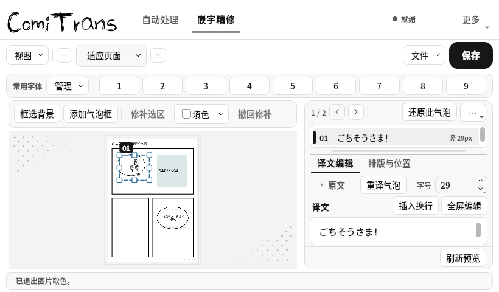 | 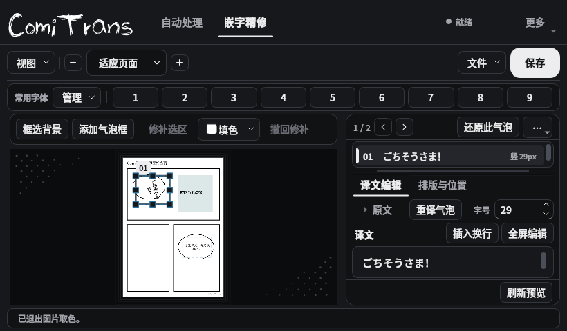 |

| Fork-Join 实时并行工作流拓扑（自动处理页） | 9 槽收藏字体、取色填色与排版控制 |
| --- | --- |
| 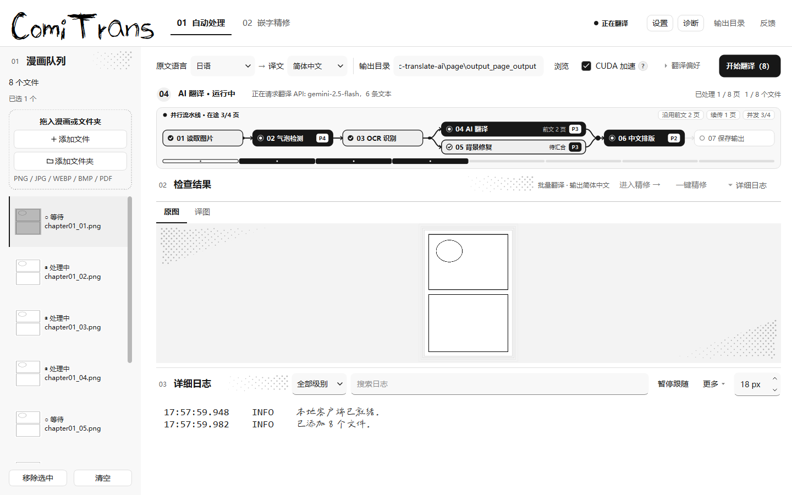 | 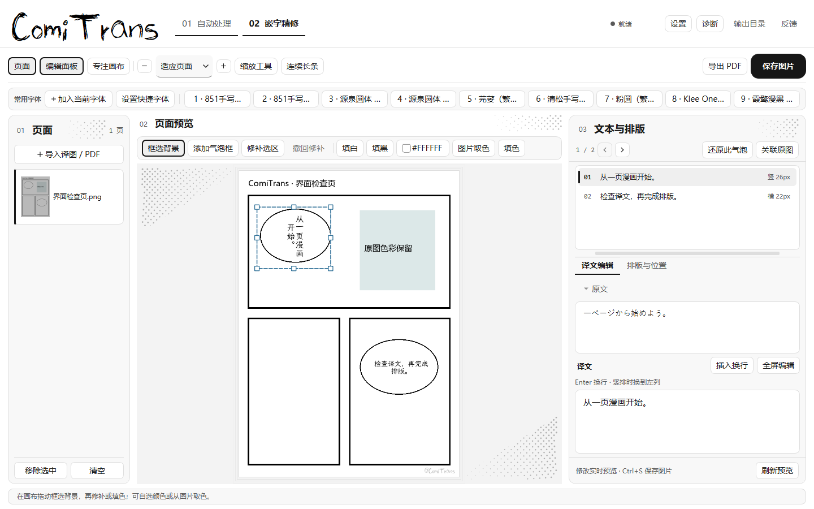 |

<details>
<summary>展开更多界面细节截图与逐字日志动图（夜墨工作流、上下文缓存偏好、取色描边、字体库与设置页）</summary>

<br>

| 夜墨下的并行工作流 | 夜墨下的嵌字精修 |
| --- | --- |
| 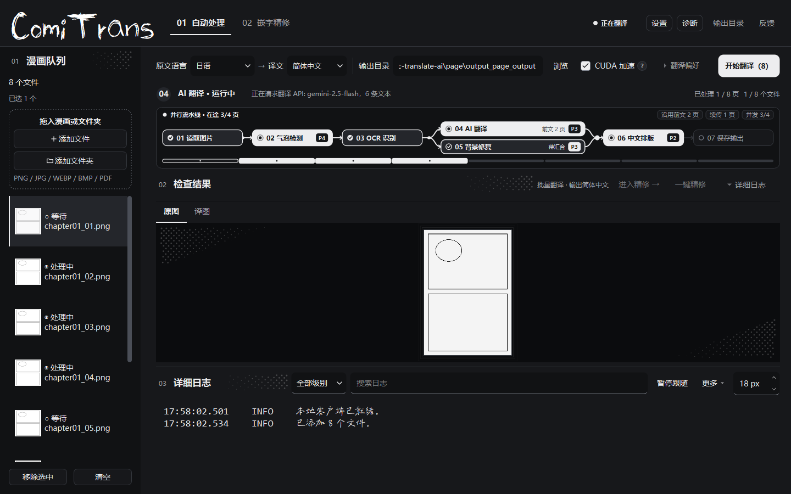 | 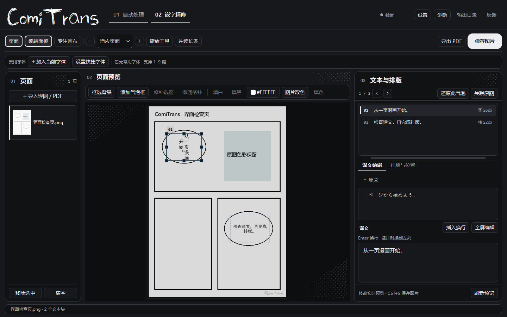 |

| 翻译偏好与上下文缓存保留 | 批处理完成与逐页状态矩阵 |
| --- | --- |
| 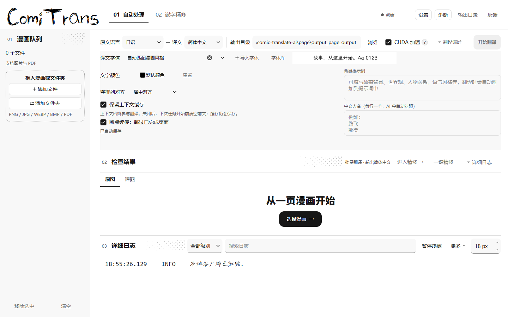 | 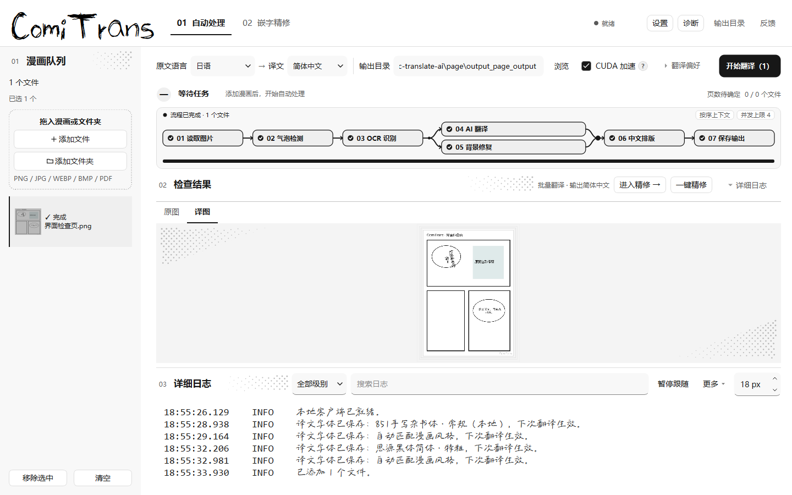 |

| 画布图片取色与自定义填色 | 文字拉伸 / 旋转 / 白字黑边竖排预设 |
| --- | --- |
|  | 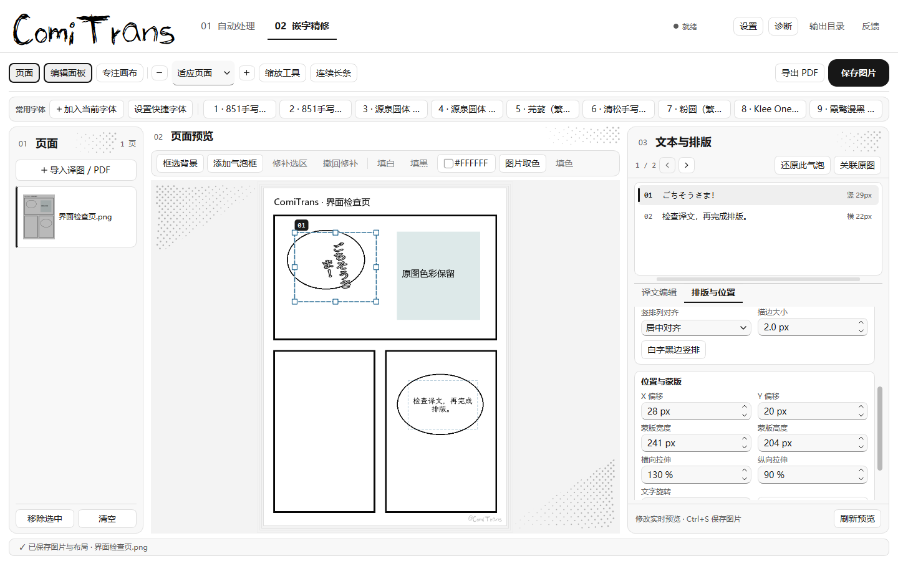 |

| 离线字体库检索（2,056 族） | 设置与翻译服务配置 |
| --- | --- |
| 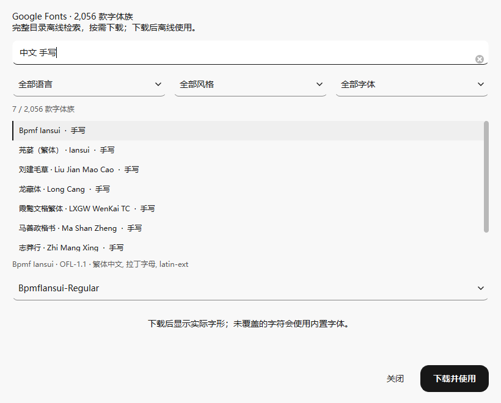 | 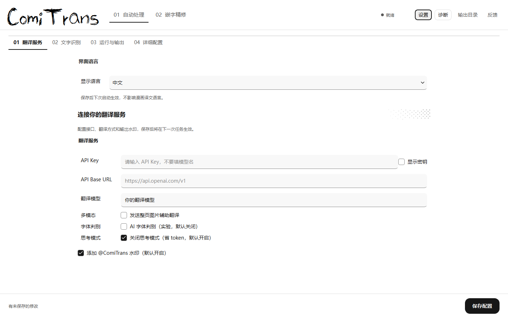 |

**快速逐字日志（实际 Qt 录屏）**：日志正文采用「Aa今日花晴 春懒猫困」，以约每秒 250 字速度展开并在积压时自动加速；支持级别筛选、搜索、字号调节、暂停跟随与选区保留，界面保留最近 5,000 条记录，完整日志同步写入磁盘。

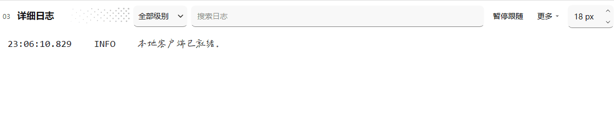

</details>

---

## 🎨 翻译前后对比

> [!NOTE]
> 以下为用户提供的漫画第 6、7 页实际汉化对比：左列为日文原图，右列为自动擦字与中文嵌字后的成品效果。

| 日文原图 | 简体中文译图 |
| --- | --- |
| 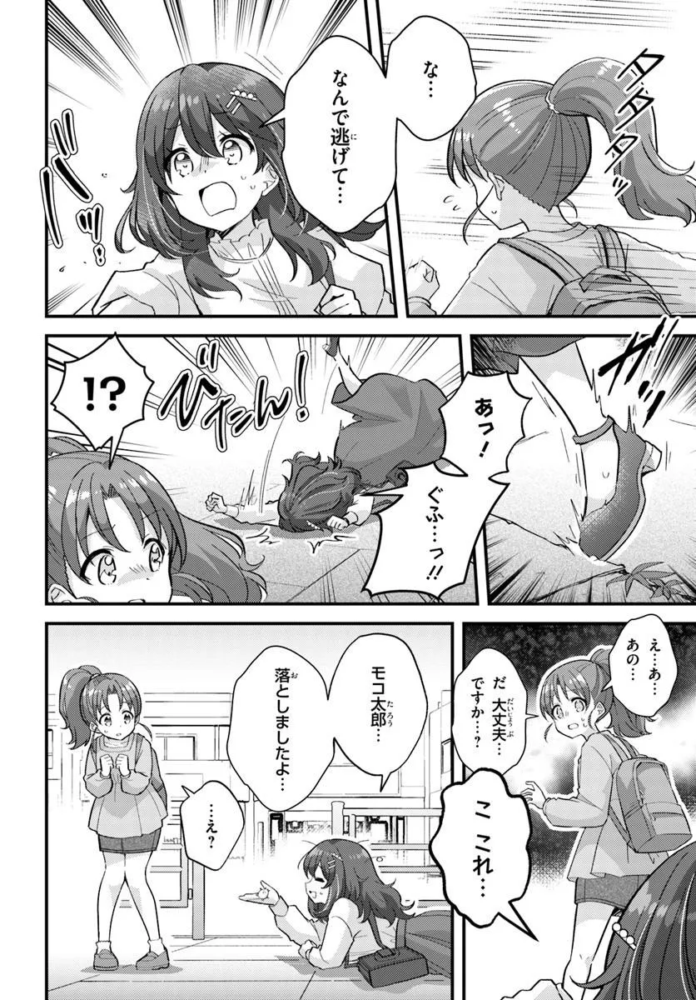 | 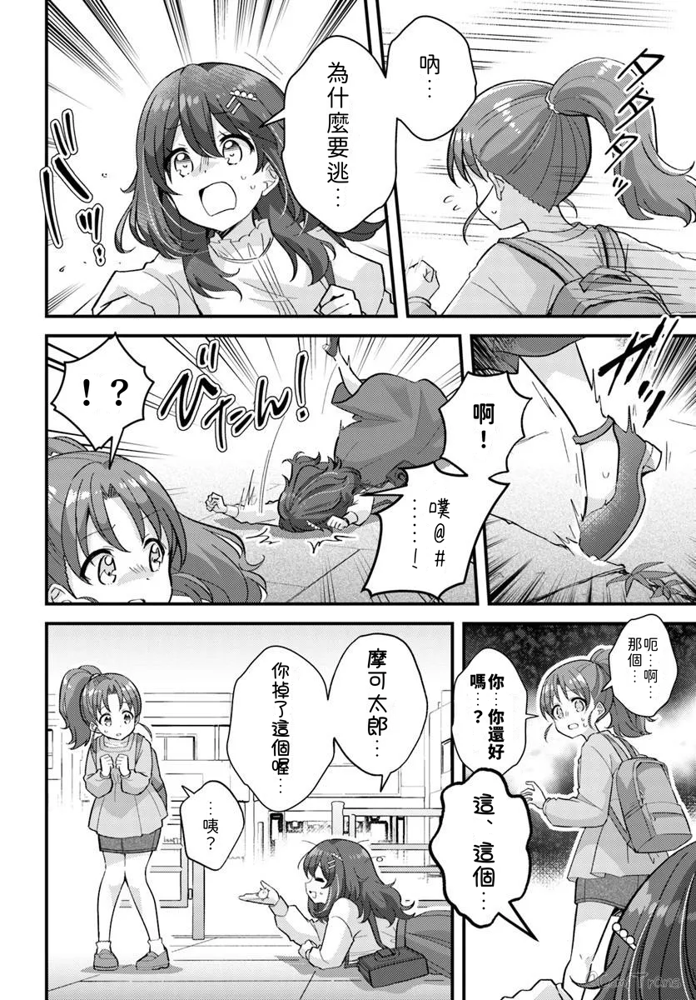 |
|  | 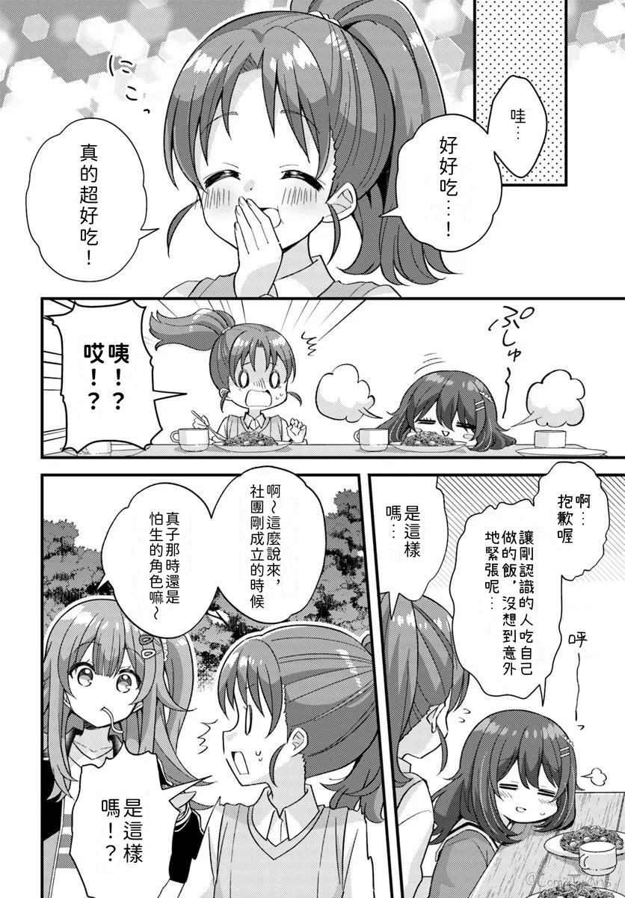 |

---

## 🚀 快速开始

### Windows 一体化安装包（推荐）

无需提前安装 Python、PyTorch 或手动拼接模型目录：

1. **下载与校验**：前往 [v2.6.0 发布页](https://github.com/Aaaaamadeus/ComiTrans/releases/tag/v2.6.0) 下载 `ComiTrans-v2.6.0-x64-Setup.exe` 与 `SHA256SUMS.txt`，在 PowerShell 中校验哈希一致：

   ```powershell
   Get-FileHash -Algorithm SHA256 .\ComiTrans-v2.6.0-x64-Setup.exe
   Get-Content .\SHA256SUMS.txt
   ```

2. **运行安装向导**：关闭正在运行的旧版 ComiTrans，双击 Setup 完成安装。
   - 本版安装包**未签名**，Windows 可能显示「未知发布者」，核对哈希后手动运行即可。
   - 用户配置、字体与默认输出均独立保存在 `%LOCALAPPDATA%\ComiTrans`，卸载或覆盖升级不会丢失用户数据。
   - 从 `v2.6.0-pre.1` 升级可直接覆盖安装；从旧 MSI/WiX 版迁移请先在系统「已安装的应用」卸载旧版；从 `v2.5.2` 等历史 ZIP 版迁移请参阅 [安装与升级指南](docs/RELEASE-v2.6.0.md#从历史版本升级--迁移)。
3. **填写翻译服务与可选 GPU**：安装后 CPU 模式即可直接加载模型。打开「设置」填写翻译 API 密钥与模型即可开始翻译；如需 NVIDIA GPU 加速，可在「设置 → 运行与输出 → GPU 安装说明与下载」按指引配置兼容驱动、CUDA 12 与 cuDNN 9（[GPU 配置指南](docs/GPU_SETUP.md)）。

> [!NOTE]
> 界面支持 **简体中文 / English / 日本語**（首次启动可选，或在「设置 → 翻译服务 → 界面语言」修改，[语言说明](docs/UI_LANGUAGES.md)）。整批翻译全部成功时有 15% 概率在右下角展示轻量 Star 提示，8 秒无操作自动收起。

<details>
<summary>源码运行（开发者 · Python 3.12+，NVIDIA GPU 可选）</summary>

```powershell
cd D:\ComiTrans
python -m venv .venv
.\.venv\Scripts\python -m pip install -r comic-translate-ai/requirements.txt

# 如需本地韩语 / 英语 PP-OCRv5 模型：
.\.venv\Scripts\python scripts/download_ocr_models.py

# 复制示例配置并启动客户端
Copy-Item comic-translate-ai/main/config.example.yaml comic-translate-ai/main/config.yaml
.\.venv\Scripts\python run.py
```

也可以直接双击 `start.bat` 启动。客户端会立即渲染主界面，模型随后在独立进程后台预热。

</details>

---

## 🧩 核心特性

### 1. 本地全 ONNX 视觉与推理管线
- **轻量无 PyTorch**：检测、日/韩/英本地 OCR、LaMa 背景修补全部基于 **ONNX Runtime**，无需安装 PyTorch / torchvision / transformers。
- **多源语言与自定义 OCR**：原生支持日语（CharSpot Small，兼容旧包 Baberu / manga-ocr）、韩语与英语（PP-OCRv5），并可配置独立 HTTP OCR 或兼容视觉模型接口。[多语言接入指南](docs/MULTILINGUAL_OCR.md)
- **原分辨率保真擦字**：只针对检测文字掩膜执行擦除；LaMa 显存紧张时自适应缩小分块而不缩图，结合纯色背景回填、网点/渐变重建与白气泡整框涂白兜底。
- **独立进程预热与 GPU 优先**：图像模型会话隔离在独立进程中预热，不卡顿界面；新安装默认优先 NVIDIA CUDA 并明确汇报实际推理设备，同时保留已有 CPU 偏好。

### 2. 上下文感知翻译与全书项目管理
- **Fork-Join 并行流水线**：OCR 完成后自动分叉并发执行「按阅读顺序带上下文的 API 翻译」与「后台线程背景修复」，汇合时自动按译文结果对账掩膜并跳过空译文气泡。[上下文与并行架构](docs/CONTEXT_TRANSLATION.md)
- **跨页上下文与断点续传**：单批最多延续 12 页 / 24,000 字符阅读上下文并原子持久化至 `.cache/translation-context.json`；默认启用断点续传，失败或中断后可复用已付费译文。[断点续传说明](docs/RESUMABLE_TRANSLATION.md)
- **作品术语库与批前试译**：在 `任务 → 作品术语库` 统一角色、地点译名（支持仅填目标译名）；整批前点击「试译」先跑开头 1–3 页，查看真实 Token 用量与自定义单价预估整本费用。
- **PDF 与 CBZ 整本工作流**：支持图片、文件夹递归、PDF 与 CBZ 导入。PDF 按需渲染并保留 `.comitrans` 项目索引与独立精修目录，完成编辑后后台无损导出 `*_translated.pdf`；CBZ 支持保存后直接「导出 CBZ」。[PDF 精修指南](docs/PDF_EDITING.md)
- **多模态可选 & 简繁一键切换**：支持发送整页图片辅助翻译（字体/字号/方向默认仍由本地智能决策），顶部「译文」选择器支持即时切换简体/繁体中文输出。[简繁输出说明](docs/CHINESE_OUTPUT.md)

### 3. 专业级嵌字精修与排版体系
- **精简单层菜单与高效画布**：单层收纳「视图」「文件」「填色」「字体管理」，配合连续长条视图、单页滚轮隔离、`F2` 全屏编辑与 `Z` 缩放工具，专注修图与嵌字。
- **多选气泡与连续样式刷**：列表 `Ctrl`/`Shift` 或画布 `Ctrl` 点击/`Shift` 框选批量改样式；支持「取样式」「应用样式到所选气泡」「样式刷」（跨页共享剪贴板、`Esc` 退出）及逐次「撤销样式」，严格保护译文与已还原气泡。
- **全书译稿与单气泡重译**：通过「全书译稿」跨页查找替换全书文本；右侧「重译气泡」可对单个气泡单独重新请求翻译。
- **全能画布修图工具**：支持手工添加气泡框、图片取色（避开辅助线）、自定义 RGB/Hex 框选填色、自选区域修补、逐气泡「还原此气泡」（保存重开后仍可切换还原），以及撤回修补。
- **15 类字体风格 & 离线字体库**：本地自动匹配对白、强调、手写、内心、旁白、拟声、标题等 15 类风格，支持 `3×` 超采样 Lanczos 渲染、拉伸（`10%–400%`）、旋转（`±180°`）、描边（`0–30 px`）与白字黑边竖排预设；内置 9 槽收藏字体快捷栏（`1–9` 键）、10 套繁体漫画字体、4 款特黑漫画字体与 **2,056 族 Google Fonts** 按需下载离线目录。[字体库说明](docs/FONT_LIBRARY.md) · [自定义字体](docs/CUSTOM_FONTS.md)

### 4. 诊断、安全控制与交付
- **逐字日志与 AI 多轮诊断**：运行日志写入 `Log/app.log`，诊断页自动汇集环境、模型路径与堆栈，支持一键生成诊断提示词并与 AI 进行多轮排障对话。
- **安全停止与更新提醒**：点击停止后等待在途请求与推理平稳收尾，不调度新页；启动时静默核对 GitHub 正式版，发现新版时在顶栏显示「有更新」提示。

---

## 🔄 翻译流水线

```text
读取图片 / PDF / CBZ ──▶ 气泡与文字检测 ──▶ 源语言 OCR
                                               │
            ┌──────────────────────────────────┴──────────────────────────────────┐
            ▼                                                                     ▼
   [ 分支 A：按阅读顺序翻译 ]                                             [ 分支 B：后台线程擦字修补 ]
   携带最多 12 页上下文请求 API                                             纯色回填 / 网点渐变 / 原尺寸分块 LaMa
            └──────────────────────────────────┬──────────────────────────────────┘
                                               ▼
                         汇合对账（空译文自动还原掩膜）──▶ 3× 超采样中文排版 ──▶ 保存输出 / 导出 PDF·CBZ
```

1. **气泡与文本检测**：ONNX 检测器输出气泡框、文字掩膜与文本行。
2. **源语言 OCR**：日语使用 CharSpot Small，韩/英使用 PP-OCRv5，或接入自定义 OCR；无原文/无译文区域保持原图。
3. **分支 A · 顺序上下文翻译**：结合作品术语库与滚动上下文（最多 12 页 / 24,000 字符）发起翻译；多模态模式附带整页图像。
4. **分支 B · 并行背景修复**：与翻译请求等待并发执行擦字；汇合时根据最终译文动态对账，清除空译文气泡的涂抹掩膜。
5. **中文排版**：按掩膜有效面积估算字号、按掩膜质心定位，横竖自动适配，长文本自动收紧并处理竖排省略号/破折号。
6. **保存与可逆精修**：输出成图、`<输出目录>_cleaned/` 无字底图与 `<输出目录>_layout/` 布局 JSON，随时可在精修页继续微调。
7. **整书汇编**：PDF 全部页面成功后按原页面尺寸无损汇编并重新打开校验（覆盖小数尺寸边缘）；CBZ 可在精修保存后导出为新压缩包。

> 服务返回 HTTP `401/403`（鉴权失败）、`402`（余额不足）或 `404`（接口/模型不存在）时，客户端会立即汇报具体原因并停止后续页面调度。

---

## 📦 模型与文档导航

### 内置 ONNX 模型清单

| 用途 | 默认模型 | 说明与文档 |
| --- | --- | --- |
| **漫画文字块与文字行** | ogkalu Small INT8 + PP-OCRv6 manga | [固定来源、许可证与 SHA256](docs/models/split-detector.json) |
| **日文 OCR** | CharSpot Small | [模型卡、词表及许可证](docs/models/charspot-small.json) · [v2.5.1 评测](docs/MODEL_UPGRADE-v2.5.1.md) |
| **韩语 / 英语 OCR** | `korean_PP-OCRv5_rec_mobile.onnx` / `en_PP-OCRv5_rec_mobile.onnx` | [固定模型来源与校验值](docs/MULTILINGUAL_OCR.md#韩语和英语模型) |
| **LaMa 背景修复** | `lama-manga-dynamic.onnx` | [来源核验](docs/MODEL_UPGRADE-v2.5.1.md) · [更多候选模型](docs/ONNX_MODELS.md) |

### 专题文档速查

| 主题 | 文档 | 主题 | 文档 |
| --- | --- | --- | --- |
| **v2.6.0 发布与迁移** | [RELEASE-v2.6.0.md](docs/RELEASE-v2.6.0.md) | **Windows 打包与签名** | [WINDOWS_INSTALLER.md](docs/WINDOWS_INSTALLER.md) |
| **上下文与并行流水线** | [CONTEXT_TRANSLATION.md](docs/CONTEXT_TRANSLATION.md) | **多语言与自定义 OCR** | [MULTILINGUAL_OCR.md](docs/MULTILINGUAL_OCR.md) |
| **PDF 精修与项目导出** | [PDF_EDITING.md](docs/PDF_EDITING.md) | **字体库与自定义字体** | [FONT_LIBRARY.md](docs/FONT_LIBRARY.md) · [CUSTOM_FONTS.md](docs/CUSTOM_FONTS.md) |
| **精修热预览与性能** | [EDITOR_LIVE_PREVIEW.md](docs/EDITOR_LIVE_PREVIEW.md) · [EDITOR_PERFORMANCE.md](docs/EDITOR_PERFORMANCE.md) | **整体架构与完整日志** | [ARCHITECTURE.md](docs/ARCHITECTURE.md) · [CHANGELOG.md](CHANGELOG.md) |

---

## 🔧 进阶说明与开发打包

<details>
<summary>使用进阶：译文字体、自定义 OCR 协议、15 类字体风格与 AI 诊断</summary>

#### 译文字体、繁简与水印控制
- **字体导入与离线字体库**：支持导入多选 `TTF / OTF / TTC / OTC`（保存于 `user_fonts/`，不污染系统字体），也可在「字体库」按名称、语言和风格检索并下载 **2,056 个 Google Fonts 字体族**；另内置 **10 个繁体漫画字体系列（12 字重）**（[清单](docs/TRADITIONAL_MANGA_FONTS.md)）与狮尾 B2/牙膏圆体特黑字重（[授权](comic-translate-ai/font_file/Manga/README.md)）。缺字按字符自动回退。
- **竖排对齐与手动换行**：在「排版与位置」选择竖排列上/中/下对齐；译文框支持按 `Enter` 或「插入换行」保留空行/空列；支持黑字白边与白字黑边预设。
- **文字水印开关**：默认在输出右下角添加半透明 Skribble `@ComiTrans` 字标，可在「设置 → 翻译服务 → 添加 @ComiTrans 水印」关闭并持久化记忆；清理底图始终保持无水印。

#### 自定义 OCR 接口协议
在「设置」中配置与翻译服务独立的 OCR 地址、密钥与超时（默认 60 秒，支持 1–300 秒）：
- **标准 HTTP OCR**：POST 发送文本区域 PNG Base64，请求体 `{"image_base64": "...", "mime_type": "image/png", "language": "fr", "model": "my-ocr"}`，返回 `{"text": "...", "confidence": 0.96}`；配置密钥时附带 `Authorization: Bearer <key>`。
- **兼容视觉模型接口**：填写 OpenAI 兼容 Base URL、独立 Key 与支持视觉输入的模型名称，调用 `chat.completions` 识别原文。
- **Python 扩展**：实现 `OcrEngine.recognize(image, language) -> OcrResult`。详见 [docs/MULTILINGUAL_OCR.md](docs/MULTILINGUAL_OCR.md)。

#### 15 类字体风格映射
| 风格 | 用途 | 默认字体 |
| --- | --- | --- |
| `dialogue` / `bold_dialogue` | 普通 / 粗体对话 | 霞鹜文楷 / 思源黑体 Heavy |
| `radiating` / `sfx` | 强调放射 / 拟声词 | 得意黑 Smiley Sans 斜体 |
| `handwriting` / `seto` / `tegaki_851` | 手写 / 濑户 / 851 随性手写（后两项支持手动指定） | setofont / 851手写杂书体 |
| `thought` / `serious` | 内心 / 严肃正式 | 思源宋体 |
| `whisper` / `cute` / `next_preview` | 低语 / 可爱 / 下回预告 | Klee One（缺字回退思源） |
| `narration` / `lxgw_marker` / `title` | 旁白 / 漫黑强调（手动）/ 章节标题 | 霞鹜文楷 / 霞鹜漫黑 / 思源黑体 Heavy |

> `multimodal_font_probe`（实验性多模态字体比对）默认关闭，策略与测试见 [docs/FONT_STYLE_STRATEGY.md](docs/FONT_STYLE_STRATEGY.md)。

#### 报错日志与 AI 诊断
- 所有运行日志写入 `Log/app.log`；「诊断」页自动汇总环境信息、模型路径、最近日志与错误堆栈，支持一键复制诊断提示词并与 AI 进行多轮对话排障（点击「清空上下文」重置）。

</details>

<details>
<summary>本地构建主程序与生成 Windows 安装包命令</summary>

1. 安装固定版本的构建依赖（构建脚本不再自动升级工具）：

   ```powershell
   .\.venv\Scripts\python -m pip install -r requirements-build.txt
   .\build_app.ps1
   ```

   如需本地联调模型，可附带 `-IncludeModels`：`.\build_app.ps1 -IncludeModels`。

2. 安装 [NSIS 3.13](https://nsis.sourceforge.io/Download) 后，生成包含默认模型的 Windows 安装包（版本号自动读取自 `comic_translate_desktop/__init__.py`）：

   ```powershell
   .\.venv\Scripts\python.exe installer/build.py --include-models
   ```

   完整构建、签名与 CI 验证流程见 [docs/WINDOWS_INSTALLER.md](docs/WINDOWS_INSTALLER.md)。历史 ZIP 发布版的 `baseline.json` 与 `SHA256SUMS.txt` 保留在 `docs/releases/`（如 [v2.5.2](docs/releases/v2.5.2/SHA256SUMS.txt)、[v2.5.1](docs/releases/v2.5.1/SHA256SUMS.txt)、[v2.4.0](docs/releases/v2.4.0/SHA256SUMS.txt)）。

</details>

<details>
<summary>项目目录结构</summary>

```text
ComiTrans
├── run.py                         # 桌面客户端入口
├── comic-translate-ai/            # AI 核心管线、ONNX 检测/OCR/LaMa 与中文排版
├── comic_translate_core/          # 源语言路由、OCR 协议、图像隔离会话与更新校验
├── comic_translate_desktop/       # PySide6 桌面客户端（主窗口、精修页、工作流对话框与动效）
├── assets/
│   ├── i18n/                      # 英文 / 日文界面翻译词典
│   ├── ui/                        # SVG 图标、UI 字体与空状态插画
│   └── font_catalog.json          # Google Fonts 目录快照（2,056 族按需下载）
├── installer/                     # NSIS 安装脚本、更新查询服务与打包验收脚本
├── scripts/                       # 字体目录维护、韩英 OCR 模型下载与 UI 截图审查
├── docs/                          # 架构、模型清单、性能基准与版本发布文档
├── tests/                         # 自动化单元测试与桌面 UI 回归套件
├── build_app.ps1                  # PyInstaller 主程序打包脚本
└── package_release.py             # Release 文件清单与校验生成脚本
```

</details>

<details>
<summary>近期版本摘要（v2.6.0 / v2.5.2 / v2.5.1 / v2.5.0）</summary>

- **v2.6.0（2026-11-23）**：单文件 Windows x64 NSIS Setup（含默认模型）、独立进程模型预热、后台正式版更新提醒、作品术语库、1–3 页试译与 Token 消耗估算、CBZ 导入与导出、精修单层菜单重构、气泡多选与连续样式刷、全书译稿跨页查找替换、单气泡重译，以及 60fps 黑白墨韵动效与双主题统一。[发布说明](docs/RELEASE-v2.6.0.md)
- **v2.5.2（2026-11-17）**：滚动翻译上下文与缓存保留、OCR 后按序翻译 ∥ 后台修补 Fork-Join 并行流水线、实时工作流拓扑图与逐页状态矩阵、手动画框/图片取色/RGB 填色/9 槽收藏字体/拉伸旋转描边预设、冷启动首帧优化与 PDF 边缘覆盖修复。[发布说明](docs/RELEASE-v2.5.2.md)
- **v2.5.1（2026-11-10）**：夜墨深色主题、画布点选、右栏拖拽分隔、F2 全屏编辑、Z 缩放工具、CUDA 开关提示、CharSpot Small 默认日语 OCR 与白气泡涂白兜底。[发布说明](docs/RELEASE-v2.5.1.md)
- **v2.5.0（2026-11-02）**：大 PDF 图片工作流与显式无损导出、原分辨率分块修补、有上限连续流水线、按页断点续传与气泡原图还原。[发布说明](docs/RELEASE-v2.5.0.md)

完整演进记录（含 v2.4.x ～ v1.x）请查阅 [CHANGELOG.md](CHANGELOG.md)。

</details>

---

## ❓ 常见问题

**1. 安装 Release 需要配置 Python 或 PyTorch 吗？**
不需要。v2.6.0 Windows Setup 已内置运行环境、中文字体与默认 ONNX 模型，安装后即可用 CPU 推理。如需 NVIDIA GPU 加速，请按软件「设置 → 运行与输出」中的官方指引安装兼容的 NVIDIA 驱动、CUDA 12 和 cuDNN 9。

**2. 模型存放在哪里？还需要单独下载模型包吗？**
v2.6.0 Setup 会自动将默认模型安装到程序目录，无需再合并模型压缩包。韩语 / 英语 OCR 模型可通过源码脚本下载或在旧版模型包中复用；历史 ZIP 版请保持 `ComiTrans\comic-translate-ai\models\` 目录结构。

**3. 为什么日语模式下部分英文文本没有被翻译？**
日语本地模式默认保留检测器标记的英文块以及拉丁字符占比较高的 OCR 结果。翻译纯英文页面时，请在工作台将「原文语言」切换为「英语」；韩语、英语及自定义 OCR 模式均会正常识别并翻译英文区域（自动混合语言路由尚未启用）。

**4. 为什么打开安装包时 Windows 提示「未知发布者」？**
当前发布的 Windows Setup 未购买商业代码签名证书。请务必从 [GitHub Releases](https://github.com/Aaaaamadeus/ComiTrans/releases) 下载，并使用本页提供的 `SHA256SUMS.txt` 核对文件哈希一致后再安装。

---

## 💬 反馈与支持

使用中遇到异常或有功能建议，欢迎在 [GitHub Issues](https://github.com/Aaaaamadeus/ComiTrans/issues) 提交，或直接点击客户端顶部的「反馈」按钮。建议附上「诊断」页自动生成的诊断提示词，以便快速定位问题。

---

## 📄 开源协议

- **项目源码**：采用 [GPL-3.0](LICENSE) 开源协议。
- **内嵌中文字体**：得意黑 Smiley Sans、霞鹜文楷 LXGW WenKai、霞鹜漫黑 LXGW Marker Gothic（SIL OFL 1.1）、Klee One、思源黑体 / 宋体、setofont（濑户字体）、851手写杂书体 均为可免费商用的开源 / 免费字体，各自授权见对应字体说明；繁体漫画字体包见 [docs/TRADITIONAL_MANGA_FONTS.md](docs/TRADITIONAL_MANGA_FONTS.md)。
- **UI 字体**：Skribble 与 Aa今日花晴 春懒猫困保留各自内嵌版权信息，来源与用途见 [assets/ui/fonts/README.md](assets/ui/fonts/README.md)。
- **AI 模型**：CharSpot Small 权重采用 CC BY-NC-SA 4.0 协议；各模型的来源、署名与完整许可条款见 [docs/ONNX_MODELS.md](docs/ONNX_MODELS.md)。
