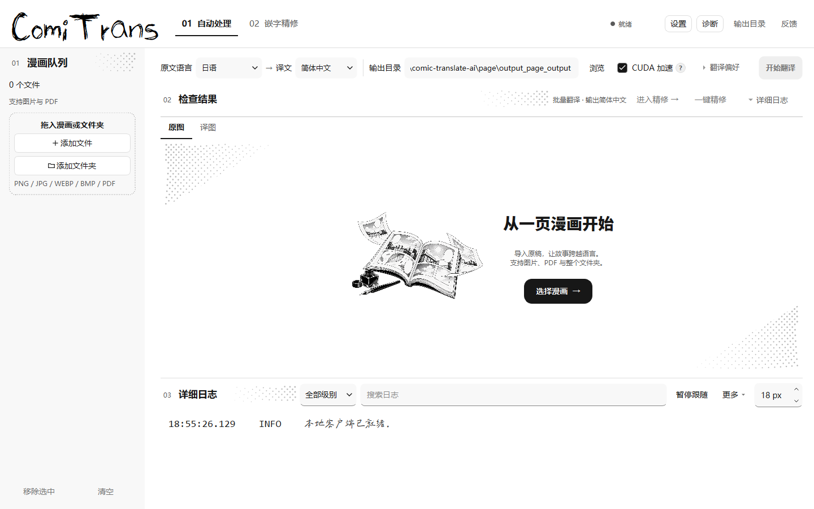
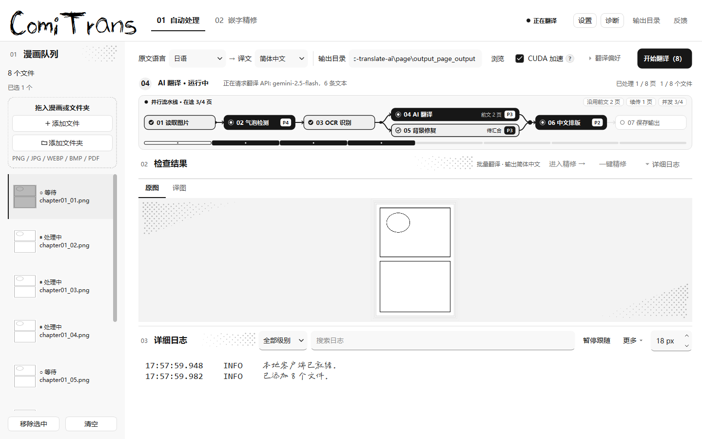
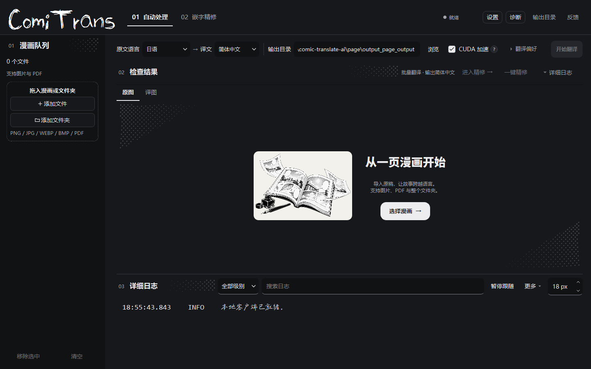
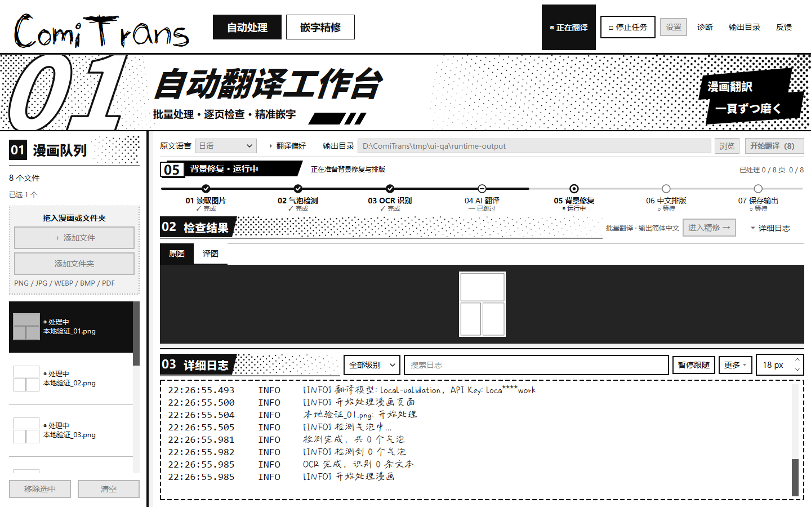
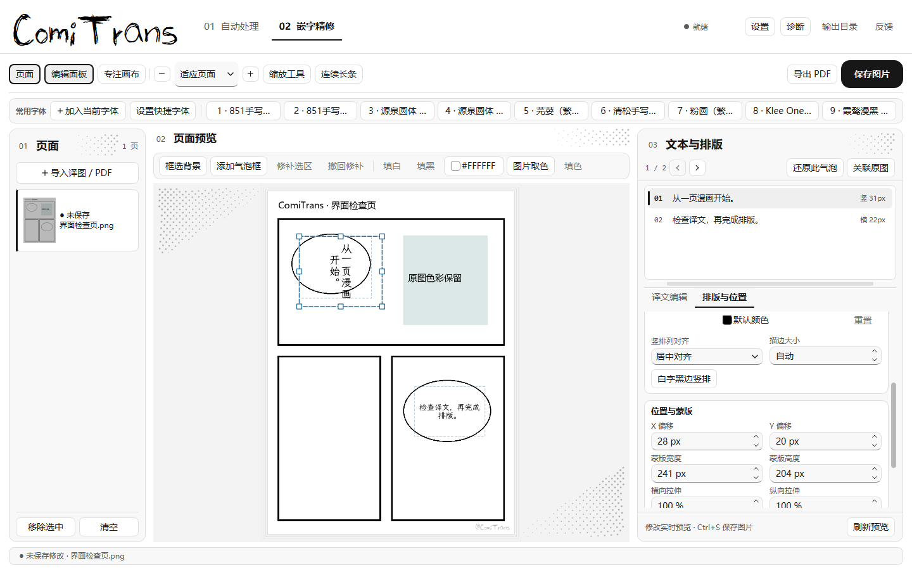
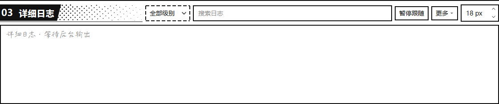
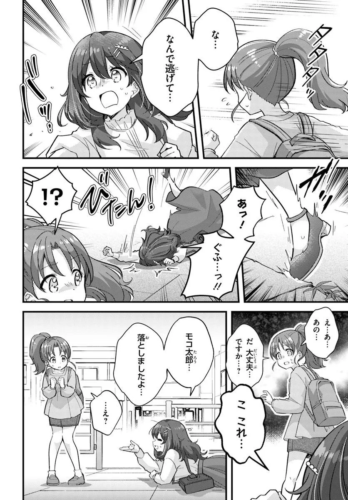
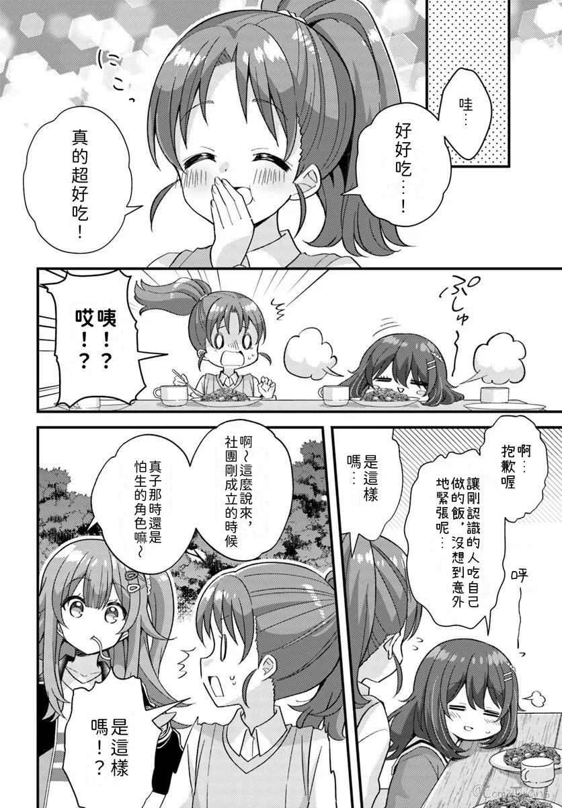

<div align="center">

**[English](README_en.md)** ｜ **[简体中文](README.md)**

<br>


</div>

Source-language selection supports Japanese, Korean, English, and **Custom OCR**, with Simplified or Traditional Chinese output. Download the local Korean/English PP-OCRv5 ONNX models using `.venv\Scripts\python scripts/download_ocr_models.py`. Custom OCR supports HTTP endpoints and compatible vision models. See the [integration guide and proposed mixed-language strategy](docs/MULTILINGUAL_OCR.md). Automatic mixed-language routing is not yet enabled.

ComiTrans is a manga translation desktop client. Detection, built-in Japanese/Korean/English OCR, inpainting, and Chinese typesetting run locally; translation uses your configured LLM API. No web frontend is required.

Since v2.2.1, detection, OCR, and inpainting are powered entirely by **ONNX Runtime**, removing PyTorch / torchvision / transformers dependencies. The app and models are released as separate packages: app updates no longer require re-downloading unchanged models.

> [!NOTE]
> **v2.5.2 update:** rolling cross-page translation context with optional cache retention, an OCR-forked sequential-translation ∥ background-repair Fork-Join pipeline, a redesigned live workflow graph on the translation page, plus manual bubble boxes, eyedropper & custom RGB fills, 9-slot favorite fonts (`1–9`), lettering stretch/rotation/outline, and fractional-edge PDF export fixes. v2.5.1 models remain reusable. [v2.5.2 release notes](docs/RELEASE-v2.5.2.md) · [Changelog](CHANGELOG.md).

## What's new in v2.5.2

- **Contextual translation & Fork-Join pipeline:** Rolling cross-page memory (up to 12 pages / 24,000 serialized chars) atomically saved to `.cache/translation-context.json`, with a "Keep context cache" preference that keeps per-page resume enabled. Right after OCR, sequential reading-order translation and background-thread page inpainting (`repair_comic_page`) run concurrently and reconcile empty translations at join. [Context & parallel pipeline guide](docs/CONTEXT_TRANSLATION.md).
- **Live Fork-Join workflow visualizer:** Replaces the 7-step straight bar on the translation page with a real-time directed graph (`Start → Detect → OCR → [Translate ∥ Inpaint] → Typeset → Save / PDF`) displaying concurrent in-flight page badges, repair-ready join state, context count, resumed pages, and a bottom per-page matrix strip.
- **Typesetting editor upgrades:** Manual bubble frame creation, canvas/strip color picking (avoiding guides), custom RGB/Hex selection fills (undoable), 9 pinned favorite fonts with `1–9` shortcuts, persisted text colors, stretch (`10–400%`), rotation (`±180°`), manual outline stroke (`0–30 px`) with a vertical white-text black-outline preset, page removal/clear controls, `1 / N` block counter, and single-page scroll isolation.
- **Startup & PDF fixes:** Defers ONNX model warmup until after first paint and covers fractional page edges during PDF export.

## What's new in v2.5.0

- **Long PDF workflow:** render pages on demand; edit individual images and explicitly export a lossless PDF. Continuous Strip loads nearby pages, and projects can open from `project.json`. [PDF guide](docs/PDF_EDITING.md).
- **Streaming translation and resume:** prepare/OCR/translate later pages while repairing the current page, with a default cap of four in-flight pages. Logs report the actual GPU/CPU provider. Resume completed pages and reuse cached valid translations. [Resume](docs/RESUMABLE_TRANSLATION.md) · [Measured performance](docs/TRANSLATION_PERFORMANCE.md).
- **Native-resolution repair:** smaller repair tiles on memory pressure, without downscaling pages. Improved masks for light/dark text, outlines, overlapping artwork, screentones and gradients; masks are independently testable and replaceable. [Mask component](docs/TEXT_MASK_COMPONENT.md).
- **Retouching controls:** background selection repair, per-block colors/outlines, word-aware Chinese wrapping, and restoration of a selected bubble's original pixels and text. Restoration remains reversible after saving. [Bubble restoration](docs/BUBBLE_RESTORATION.md).
- **Large-project editing:** background indexing, decoding and saving; bounded loading and visible-canvas reuse; edits made during saving remain dirty. Preference panels retain manual choices across resizing and focus mode. [Editor measurements](docs/EDITOR_PERFORMANCE.md).
- **API reliability:** strict JSON Schema where supported, with local type/count validation on every fallback; isolated translation, mask, persistence and scheduling components. [JSON contract](docs/TRANSLATION_JSON_CONTRACT.md) · [Architecture](docs/ARCHITECTURE.md).

A three-page offline scheduling comparison measured **42.43 → 37.85 seconds**, with identical output pixels and a simulated two-second API delay. This is not a live API or whole-PDF speed guarantee. Complex backgrounds may still need manual retouching. The independent retouch plugin API is designed; host-side plugin loading is not implemented.

## Manga workbench

A black-and-white manga workbench with open section headings, local halftones, the Skribble wordmark, and soft controls. Workspaces open directly into their tools. Import fonts and pin up to 9 favorite translation fonts (`1–9` shortcuts) with a real glyph preview; the bottom Fork-Join workflow graph tracks live in-flight pages, `AI Translate ∥ Inpaint` branches, rolling context count, and a per-page status strip. The editor canvas preserves the artwork's colors.

**Automatic processing**



**Fork-Join live workflow visualizer**



**Night mode (Night ink)**

Settings → Runtime & output → Appearance switches between Follow system / Paper / Night ink. It applies instantly and recolors the Windows title bar too; Night ink changes the UI and the area around the canvas only, never the manga pixels or exports.

| Automatic processing | Typesetting |
| --- | --- |
|  |  |

<details>
<summary>Processing, mask editing, and font library screenshots</summary>

The processing capture uses real local models on text-free test pages, without an external translation request.






</details>

**Fast character reveal — recorded from Qt with UI test messages**

Logs use the Aa handwriting font and reveal at about 250 characters per second, accelerating when messages accumulate. Copy, export, errors, and task completion flush the full text. Filtering, search, font size, pause-follow, and text selection remain available. The view retains 5,000 records; complete logs are stored on disk.



## Before / After

> [!NOTE]
> User-provided examples from pages 6 and 7: Japanese originals on the left, with their corresponding Simplified Chinese translations on the right.

| Before | After |
| --- | --- |
|  |  |
|  |  |

## Table of Contents

[Manga workbench and log animation](#manga-workbench) · [OCR interfaces](#ocr-interfaces) · [Retouch plugin API design (Chinese)](docs/RETOUCH_PLUGIN_API.md) · [Detailed changelog](CHANGELOG.md)

1. [Key Features](#key-features)
2. [Quick Start](#quick-start)
3. [Usage](#usage)
4. [Translation Pipeline](#translation-pipeline)
5. [Models](#models)
6. [Packaging & Release](#packaging--release)
7. [Project Structure](#project-structure)
8. [Changelog](#changelog)
9. [FAQ](#faq)
10. [Feedback](#feedback)
11. [License](#license)

## Key Features

- **Native desktop UI**: PySide6 app with a manga magazine design and a clean editing canvas.
- **Source languages and OCR**: Japanese, Korean, English, or a custom language; independent HTTP and compatible vision OCR endpoints.
- **All-ONNX inference**: text detection, Japanese/Korean/English local OCR, and LaMa inpainting all use ONNX; no PyTorch required.
- **Split release packages**: models ship separately, so app updates do not require re-downloading models.
- **Startup warmup**: the AI pipeline loads automatically when the app opens.
- **GPU inference**: new installations prefer NVIDIA CUDA. Settings provide official CUDA/cuDNN installation links; a compatible NVIDIA driver is required; logs report the actual device. Existing CPU preferences are preserved.
- **Multimodal translation toggle**: sends the full page image to the AI for visual context; pure-text mode sends OCR results. Font selection, size, and orientation are local by default. Experimental font comparison requires a separate opt-in.
- **Whole-PDF translation**: import PDFs alongside images, translate them page by page, and create one `*_translated.pdf` with the original page order and page sizes.
- **15 font categories**: dialogue, bold dialogue, emphasis, handwriting, Seto, 851 handwriting, thought, whisper, serious, narration, SFX, LXGW Marker, cute, preview, and title styles with per-glyph fallback.
- **Searchable open-source font library**: search fonts on the translation and editor pages. The Google Fonts snapshot includes 2,056 families in an approximately 1 MB catalog; font files download on demand for offline use. TTF / OTF / TTC / OTC imports remain available. Manual editor choices affect only the selected block and override the translation default, with per-glyph fallback. [Font library guide](docs/FONT_LIBRARY.md).
- **Mask-based erasing and typesetting**: erasing only removes the detector text mask; layout area and center follow the mask.
- **Manual typesetting with live preview**: adjust font style, actual font size, direction, X/Y offsets, and layout mask dimensions per block. Drag mask corners or edges to resize, or drag inside to move. The canvas updates automatically; saving exports the current result.
- **Error logs with AI diagnosis**: logs go to `Log/app.log`, diagnosis prompts are auto-generated, and multi-turn AI diagnosis is supported.
- **Batch folder selection**: pick a whole folder and images/PDFs are added recursively.
- **Safe cancellation**: stop requests remain visible while the current inference/request finishes; remaining pages are not scheduled.
- **Issue feedback**: jump to your configured GitHub Issues link from the top-right button.
- **Adjustable layout**: resize the main areas, preview, and log panels by dragging.

## Quick Start

The interface supports **中文 / English / 日本語**, with Chinese as the default. Choose a language on first launch, or change it under **Settings → Translation service → Interface language** and save; settings changes apply on the next launch. This does not change the manga translation language. [Interface language guide](docs/UI_LANGUAGES.md).

A fully successful translation batch has a 15% chance of showing a small repository support prompt in the bottom-right corner. It closes after eight idle seconds or via its X button; GitHub opens only when its action button is clicked.

### Release users (recommended)

1. Download `ComiTrans-v2.5.2-app.zip` from the [v2.5.2 release](https://github.com/Aaaaamadeus/ComiTrans/releases/tag/v2.5.2); for fresh installs or upgrades from v2.5.0 and earlier, also download `ComiTrans-v2.5.2-models.zip` (identical to v2.5.1 models; existing v2.5.1 users can reuse their models folder).
2. Extract the required archives into the same parent directory and merge their top-level `ComiTrans` folders, preserving the subfolder structure. The final model path is `ComiTrans\comic-translate-ai\models\`.
3. Double-click the merged `ComiTrans.exe` and enter your translation API key and model on the "Settings" page.

Upgrading from v2.5.1: reuse your existing models directly. Upgrading from v2.3.0 / v2.5.0: merge the v2.5.1+ model archive to switch to the lighter CharSpot Small Japanese OCR and CUDA-aware dual detector. Keep your existing `config.yaml`, entire `user_fonts` folder, and output files.

Release users do not need Python, PyTorch, or pip. GPU acceleration requires a compatible NVIDIA driver, CUDA 12 and cuDNN 9. Open Settings → Runtime & Output → GPU setup and downloads to install the portable runtime or to open official installer links. Reuse a compatible environment; CPU users do not need GPU libraries. [Setup guide](docs/GPU_SETUP.md). New installations prefer GPU; if CUDA cannot start, the app reports its CPU fallback. Existing CPU preferences are preserved.

To upgrade to v2.5.2, close the app and extract `ComiTrans-v2.5.2-app.zip` into a new folder. Copy `config.yaml`, `user_fonts/` and `comic-translate-ai/models/` from the old installation to the same relative locations. Keep output images and their companion `_cleaned` and `_layout` folders together. Keep the old installation until the new one works. This version uses the full app archive; see the [v2.5.2 update guide](docs/RELEASE-v2.5.2.md).

### Run from source (developers)

Python 3.12+ is recommended; an NVIDIA GPU with CUDA support is optional.

```powershell
cd D:\ComiTrans
python -m venv .venv
.\.venv\Scripts\python -m pip install -r comic-translate-ai/requirements.txt
```

Copy the example config:

```powershell
Copy-Item comic-translate-ai/main/config.example.yaml comic-translate-ai/main/config.yaml
```

Run the client:

```powershell
.\.venv\Scripts\python run.py
```

You can also double-click `start.bat`. The AI pipeline warms up automatically after launch.

## Usage

1. Click "Add Files" or "Add Folder", or drag images, PDFs, or folders into the window.
2. Configure the translation API in Settings, then choose Source Language on the workbench. Japanese Auto uses CharSpot Small (with legacy Baberu/manga-ocr packs still supported); Korean/English use PP-OCRv5. Choose Custom OCR for another language or provider.
3. Enable "Multimodal Translation" to send the full page image to the AI; disable it for pure-text translation. Both modes use local font selection and typesetting by default.
4. Expand "Preferences" on the translation page to configure background prompts, Chinese character names (one per line), and optional "Keep context cache" (keeps page resume locked on across runs).
5. Click "Start Translation" and follow live in-flight stages, Fork-Join parallel progress, and per-page states in the workflow graph below.
6. On failure, open the "Diagnostics" page for diagnosis prompts, or click the Issue button.
7. Select a text block in "Typesetting Refinement". Drag its mask corners or edges to resize, or drag inside to move; press Esc during a drag to restore its starting geometry. Font size, X/Y offsets, and exact dimensions are also available under “排版与位置”. The canvas updates automatically. Click Save Image or press Ctrl+S to export the current result. See the [live preview guide](docs/EDITOR_LIVE_PREVIEW.md).

### Translation fonts

In the editor, “排版与位置 → 竖排列对齐” selects top, center, or bottom alignment for vertical columns. Top and bottom use the longest column as their reference while keeping the text group centered. Each block retains its choice in saved layouts and live previews.

Press **Enter** or click “插入换行” in the editor to insert a hard break: horizontal text continues on the next row, vertical text in the next column to the left. Consecutive breaks preserve blank rows or columns. Preview, saved images, and restored layouts retain these breaks. “排版与位置 → 文字效果” offers black text with white outlines and white text with black outlines. [Editor guide](docs/EDITOR_LIVE_PREVIEW.md).

Vertical ellipsis and em-dash runs stay together across automatic column breaks, including common alternate glyphs. Ellipsis dots are evenly spaced and dashes form continuous vertical lines; explicit line breaks retain their positions.

Swei B2 Sans and Swei Toothpaste are bundled in separate SC and TC Black faces (four fonts, approximately 58.6 MiB) for bold emphasis and rounded outline lettering. They are visual alternatives rather than identification of the original Japanese reference fonts. [Sources and licenses](comic-translate-ai/font_file/Manga/README.md).

Use the “译文” selector on the translation page to switch between **Simplified and Traditional Chinese**. The choice saves automatically and applies to subsequent image and PDF translations, including continuation requests and local output normalization. Existing results, editor drafts, and font choices are preserved. [Chinese output guide](docs/CHINESE_OUTPUT.md).

Expand “翻译偏好” on the translation page to choose the default font and vertical column alignment. The panel remembers manual expansion choices, and settings save automatically. A specific font applies to all translated text; “自动匹配漫画风格” restores the existing style fonts. “＋ 导入字体” imports multiple TTF, OTF, TTC, or OTC files and selects the last successful import. Font collections use their first face. Default alignment is recorded in newly translated layouts; existing editor drafts retain their own choices.

Both pages support name search in their font selectors. Open “字体库” to filter Google Fonts by name, language, or style, choose a face, and click “下载并使用”. The full catalog is searchable offline, and downloaded fonts remain available without a connection. Ten families in the snapshot lack a license attachment and are currently view-only. See the [font library guide](docs/FONT_LIBRARY.md).

The application also bundles **10 Traditional Chinese manga font families in 12 faces**, available offline on first use, including GenSen Rounded, Huninn, Iansui, LXGW WenKai TC, Naikai, Jason Handwriting 3, Source Han Sans/Serif TC, Swei Sugar and Pop Gothic. Original font files total approximately 183.4 MiB, with upstream notices and provenance included. [Full list](docs/TRADITIONAL_MANGA_FONTS.md). Font selectors show concise Chinese names and localized weights while keeping original English names searchable. The editor gives the selector a full row, shows a wrapping full-name label, and widens popup lists.

Choices save automatically and apply to the next translation. The editor refreshes its preview while retaining drafts and explicit per-block font choices; Save Image writes the updated output. Select “跟随翻译默认字体” to restore the default for a block. Imported and downloaded fonts are stored in the app's `user_fonts` folder without system installation. Duplicate files are reused and missing glyphs fall back per character. Keep the entire `user_fonts` folder when moving or updating the app. See the [font guide](docs/CUSTOM_FONTS.md).

The `@ComiTrans` watermark is enabled by default. To disable it, uncheck Add @ComiTrans Watermark on the first Settings tab (Translation Service) and save the configuration. Previously saved off settings are preserved. Subsequent image translations and every PDF page receive a small, translucent Skribble wordmark in the lower-right corner when enabled. The current editor page also updates its preview; click Save Image to write it. Repeated saves do not accumulate the watermark, and the clean background remains unmarked.

Per-page resume is enabled by default. After a network failure, cancellation, or restart, use the same source files, output folder, and translation settings to skip completed pages and reuse saved translations. Uncheck Resume in Translation Preferences to start over. [Resume guide](docs/RESUMABLE_TRANSLATION.md).

A PDF is shown as one file task and processed through a bounded page pipeline. ComiTrans retains the translated PDF, a matching `.comitrans.json` index, and a separate directory of editable pages. Open the result in the Typesetting Editor or import the translated PDF to adjust text, layout, and backgrounds. Continuous Strip mode lets you scroll vertically and click a page to edit it in place. Editing and Save Image operate on individual images. Export PDF explicitly assembles saved pages in the background with lossless compression, progress and cancellation, preserving page count, order, and sizes. You can also import the project directory’s `project.json` without the PDF. Content is rasterized; password-protected PDFs are not supported. Keep the PDF, index, and project directory together when moving them. [PDF editing guide](docs/PDF_EDITING.md).

### OCR interfaces

Choose the source language and engine in Settings. OCR credentials, endpoint, and model are independent of the translation service.

| Engine | Configuration |
| --- | --- |
| Japanese local | Auto uses CharSpot Small, with Baberu and manga-ocr supported in older installations |
| Korean / English local | PP-OCRv5 ONNX; both models are included in the v2.3.0 model archive |
| Standard HTTP | Full POST endpoint; receives a PNG text-region crop as Base64 and returns the original text |
| Compatible vision API | OpenAI-compatible Base URL, independent key, and an image-capable model; uses `chat.completions` for OCR |

HTTP request (`model` is optional):

```json
{"image_base64": "<PNG Base64 without data: prefix>", "mime_type": "image/png", "language": "fr", "model": "my-ocr"}
```

Response (`confidence` is optional and must be 0–1 when supplied):

```json
{"text": "Bonjour le monde !", "confidence": 0.96}
```

When a key is configured, requests include `Authorization: Bearer <key>`. Return `{"text":""}` for no text. An OCR error fails that page before erasing the original. The timeout defaults to 60 seconds and accepts 1–300 seconds. Custom OCR sends region images to the selected service; multimodal translation also sends full-page images to the translation provider.

Python backends implement `OcrEngine.recognize(image, language) -> OcrResult`. Each task uses one source language; automatic mixed-language routing is not implemented. See the [full integration guide](docs/MULTILINGUAL_OCR.md) for fields, model downloads, and Python examples.

### Font styles

| Style | Usage | Default font |
| --- | --- | --- |
| `dialogue` / `bold_dialogue` | Normal / bold dialogue | LXGW WenKai / Source Han Sans Heavy |
| `radiating` / `sfx` | Emphasis / sound effects | Smiley Sans Oblique |
| `handwriting` | Handwritten notes | setofont |
| `seto` | Seto handwriting (optional, manual) | SetoFont |
| `tegaki_851` | Casual 851 handwriting (optional, manual) | 851tegakizatsu with handwriting/body fallback |
| `thought` / `serious` | Thoughts / formal text | Source Han Serif |
| `whisper` / `cute` | Whisper / playful text | Klee One with glyph fallback |
| `narration` | Wide narration strips | LXGW WenKai |
| `sfx` | Sound effects | Smiley Sans Oblique |
| `lxgw_marker` | Marker emphasis (optional, manual) | LXGW Marker Gothic |
| `next_preview` / `title` | Preview / title | Klee One / Source Han Sans Heavy |

Normal bubbles default to `dialogue`; OCR content, detector class, original stroke weight, and box geometry select the other styles. Detector orientation is preserved unless the aspect ratio strongly contradicts it. The editor offers Auto, explicit Vertical, and explicit Horizontal modes.

`seto`, `tegaki_851`, and `lxgw_marker` can be selected per block in the editor; the local automatic heuristic does not select these three styles yet. Experimental font comparison runs only when both `multimodal` and `multimodal_font_probe` are enabled; the latter is disabled by default. The AI compares locally rendered gothic, mincho, and handwriting candidates, then local gates and permissions decide whether to apply the result. A gothic result on body text can map to `lxgw_marker`. See [docs/FONT_STYLE_STRATEGY.md](docs/FONT_STYLE_STRATEGY.md) for the strategy and measurements.

Typesetting renders text on a local 3x supersampled surface and downsamples it with Lanczos, so small dialogue is no longer drawn directly at low resolution. Normal bubbles also avoid a forced white outline for softer edges, while non-bubble text on complex backgrounds keeps an outline for readability.

### Error logs & AI diagnosis

- All runtime logs are written to `Log/app.log`.
- The "Diagnostics" page gathers environment info, model paths, recent logs, and stack traces.
- Copy diagnosis prompts, copy raw logs, or open the log file directly.
- AI diagnosis keeps the current log context and multi-turn memory; only "Clear Context" resets it.

## Translation Pipeline

1. **Bubble & text detection**: an ONNX detector outputs bubbles, text masks, and text lines.
2. **Source-language OCR**: Japanese uses CharSpot Small (legacy Baberu/manga-ocr packs remain supported), Korean and English use PP-OCRv5 text-line recognition, or a custom OCR service can be selected. The English-skip rule applies only to Japanese local mode. Empty source/translation regions retain the original artwork.
3. **Fork branch A · sequential contextual translation**: pure-text mode sends OCR results; multimodal mode sends the page image, carrying rolling context across up to 12 recent pages (24,000 serialized chars). Local heuristics select fonts by default while size and orientation stay local.
4. **Fork branch B · parallel background inpainting**: runs concurrently in a dedicated worker thread while waiting on the translation API, erasing detected masks via solid fill, screentone/gradient reconstruction, or tiled LaMa; join-stage reconciliation restores masks for empty translations.
5. **Chinese typesetting**: font size is estimated from the mask area, text is centered on the mask centroid, orientation adapts automatically, and long text gets tighter sizing.
6. **Save & edit**: output images are saved, cleaned canvases go to `<output_dir>_cleaned/`, layout JSON goes to `<output_dir>_layout/`, and the editor lets you refine everything manually (including manual bubble boxes, eyedropper & custom fills, `1–9` favorite fonts, stretch, rotation, and outlines).
7. **PDF assembly**: once every page succeeds, pages are rebuilt at their original sizes (covering fractional page edges) and the PDF is reopened for validation; no partial PDF is emitted if a page fails.

When the translation provider returns 401/403 (authentication), 402 (insufficient balance), or 404 (endpoint/model not found), the client reports the real cause and stops scheduling remaining pages. HTTP 402 requires funding the API account or switching to a key with available credit.

## Models

| Purpose | Model | Source |
| --- | --- | --- |
| Comic text regions and lines | ogkalu Small INT8 + PP-OCRv6 manga | [Pinned sources, licenses and SHA256](docs/models/split-detector.json) |
| Japanese OCR | CharSpot Small | [Model, vocabulary and license](docs/models/charspot-small.json) |
| Korean / English OCR | `korean_PP-OCRv5_rec_mobile.onnx` / `en_PP-OCRv5_rec_mobile.onnx` | [Pinned sources and checksums](docs/MULTILINGUAL_OCR.md#韩语和英语模型) |
| LaMa inpainting | `lama-manga-dynamic.onnx` | [Pinned source and license audit](docs/MODEL_UPGRADE-v2.5.1.md) |

The v2.5.1 local preview ships only CharSpot Small for Japanese OCR and supports existing legacy model directories. Default detection uses Small with manga line-based box refinement. The full model set is 284.712 MB (48.71% of v2.5.0). On 22 crops from three pages, character errors fell from 12 to 5. [Evaluation](docs/MODEL_UPGRADE-v2.5.1.md) · [Upgrade and rollback](docs/RELEASE-v2.5.1.md)

More model sources, alternative ONNX versions, and better detection candidates: [docs/ONNX_MODELS.md](docs/ONNX_MODELS.md).

## Packaging & Release

### Build the app

Install the pinned build dependencies first; the build script does not upgrade tools automatically:

```powershell
.\.venv\Scripts\python -m pip install -r requirements-build.txt
.\build_app.ps1
```

By default the app is built without models. For local testing with models:

```powershell
.\build_app.ps1 -IncludeModels
```

### Generate release packages

```powershell
python package_release.py --output release/v2.5.2
```

The local build produces two v2.5.2 archives.

- `ComiTrans-v2.5.2-app.zip`: program only, no models
- `ComiTrans-v2.5.2-models.zip`: ONNX models matching v2.5.1 (Japanese CharSpot Small, dual detectors, Korean & English OCR, LaMa); existing v2.5.1 models can be reused

CUDA/cuDNN libraries are not distributed in this release. GPU users can open official installation links from Settings. The release includes `SHA256SUMS.txt` and `baseline.json`.

Version metadata is stored and committed in the source repository:

- [docs/releases/v2.5.2/baseline.json](docs/releases/v2.5.2/baseline.json): v2.5.2 target build fingerprint
- [docs/releases/v2.5.2/SHA256SUMS.txt](docs/releases/v2.5.2/SHA256SUMS.txt): v2.5.2 app, models and target baseline checksums
- [docs/releases/v2.5.1/baseline.json](docs/releases/v2.5.1/baseline.json): v2.5.1 build fingerprint
- [docs/releases/v2.5.1/SHA256SUMS.txt](docs/releases/v2.5.1/SHA256SUMS.txt): v2.5.1 checksums
- [docs/releases/v2.4.0/baseline.json](docs/releases/v2.4.0/baseline.json): file hashes and build fingerprint for generating future patches
- [docs/releases/v2.4.0/SHA256SUMS.txt](docs/releases/v2.4.0/SHA256SUMS.txt): checksums for the app, models and baseline

Extract the models archive into `ComiTrans\comic-translate-ai\models\`.

## Project Structure

```text
ComiTrans
├── run.py                         # desktop client entry
├── comic-translate-ai/            # AI core
│   ├── main/
│   │   ├── comic_translator_pipeline.py
│   │   ├── onnx_text_detector.py  # ONNX text detection
│   │   ├── onnx_manga_ocr.py      # ONNX Japanese OCR
│   │   ├── onnx_baberu_ocr.py     # Baberu ONNX OCR (legacy)
│   │   ├── manga_lama.py          # ONNX inpainting
│   │   └── vertical_typesetter.py # Chinese typesetting
│   ├── models/                    # model weights (beside exe in releases)
│   └── font_file/                 # Chinese fonts
├── comic_translate_core/          # source languages, OCR protocol, PP-OCR
├── comic_translate_desktop/       # PySide6 desktop client
├── assets/ui/                     # UI fonts, SVG icons, and empty-state artwork
├── assets/font_catalog.json       # Google Fonts snapshot; files download on demand
├── user_fonts/                    # local imports/downloads and licenses (not committed)
├── scripts/update_font_catalog.py # catalog maintenance
├── scripts/download_ocr_models.py # Korean/English model downloads
├── docs/ui-review/                # UI screenshots and log animation
├── docs/ONNX_MODELS.md            # model sources & alternatives
├── requirements-build.txt         # pinned build dependencies
├── build_app.ps1                  # build script
└── package_release.py             # release split script
```

## Changelog

### v2.5.2 (2026-11-17)

- Rolling cross-page translation context with atomic `.cache/translation-context.json` persistence and a "Keep context cache" toggle locking per-page resume.
- Fork-Join pipeline after OCR running sequential API translation in parallel with dedicated-thread background repair (`repair_comic_page`), reconciling empty translations at join; redesigned translation page workflow visualizer with in-flight page badges, context/resume counters, and per-page matrix strip.
- Editor upgrades: manual bubble frames, canvas/strip eyedropper & custom RGB/Hex fills, 9-slot favorite fonts (`1–9` shortcuts), persisted text colors, stretch (`10–400%`), rotation (`±180°`), manual outline stroke (`0–30 px`), vertical white-text black-outline preset, page-list cleanup controls, `1 / N` block counter, and single-page scroll isolation.
- Deferred model warmup until after first paint and fixed fractional-edge coverage during PDF export.
- [v2.5.2 release notes](docs/RELEASE-v2.5.2.md) · [Full changelog](CHANGELOG.md).

### v2.5.1 (2026-11-10)

- Night ink dark theme, direct canvas bubble hit-testing & selection, resizable right inspector splitter, `F2` full-screen editor, zoom HUD & `Z` zoom tool, Advanced settings tab, one-click retouch, and undoable white/black selection fills.
- CUDA toggle with detector tradeoff hint and CharSpot Small default Japanese OCR (models unchanged for v2.5.2). [v2.5.1 notes](docs/RELEASE-v2.5.1.md).

### v2.5.0 (2026-11-02)

- Image-based PDF editing and explicit lossless export; native-resolution tiled repair, improved masks/background reconstruction and outline handling.
- Bounded streaming translation, actual CUDA provider reporting, faster equivalent background filtering, per-page resume and cached valid translations.
- Continuous Strip, background project/page/save jobs and regional composition; persistent preference panels and focus-mode choices.
- Selection repair, per-bubble restoration, default/per-block text colors and word-aware Chinese wrapping.
- Separate translation/persistence services with strict JSON validation; diagnostics no longer probe PyTorch/CUDA.
- Official GPU setup links and installed runtime discovery; new installations prefer GPU. CUDA/cuDNN are not bundled. Existing models can be reused.
- [Detailed update, installation and limitations](docs/RELEASE-v2.5.0.md).


### v2.4.1 (2026-10-18)

- English and Japanese interfaces, a first-launch language chooser and a Settings language option; Chinese remains the default.
- Continuous vertical ellipses and dashes with consistent preview and output.
- A 15% Star prompt after successful batches, with an X button and eight-second idle dismissal.
- Simplified/Traditional Chinese output with local normalization and bundled manga fonts.
- Translation font and default vertical alignment choices grouped inside collapsible Translation Preferences.
- Manual hard line breaks, outline lettering, top/center/bottom column alignment and persistent live editor previews.
- Default watermark with an off switch on the first Settings tab; prior off choices remain honored.
- Full app and model archives are provided together; extract and merge their top-level `ComiTrans` folders. Existing models remain reusable. [Update guide](docs/RELEASE-v2.4.1.md).

### v2.4.0 (2026-10-13)

- Added a file-level SHA256 baseline, build fingerprint and Windows patch launcher. Future minor releases can use file-level patches with source-build checks, backups and restoration on failed writes. [Patch guide](docs/PATCH_UPDATES.md).
- Baselines and checksums are stored in the source repository. Releases provide the app and model archives; the app includes its update baseline.
- Open manga workspaces with softer buttons and borders, local halftones, and empty-state illustrations; removed large chapter banners and supplied missing Japanese header glyphs.
- Font imports and default translation font selection on the translation page; an approximately 1 MB Google Fonts catalog with name search, language/style filters, background downloads, license preservation, and offline reuse.
- Eight mask resize handles, free resizing, position dragging, and Esc to cancel a drag. Text, font, size, and X/Y changes preview automatically; saving exports the current result and persists its layout.
- Fixed global defaults overriding editor font choices and whole-text replacement on missing glyphs. Manual fonts affect only the selected block, retain per-glyph fallback, and survive save/reload.
- Removed the approved 82 legacy web, obsolete CLI, and training files. Simplified ONNX imports, warmup, and build dependencies; closed diagnosis HTTP clients correctly.
- Separate multimodal translation and experimental font-comparison switches, with comparison disabled by default. Improved local candidates, voting, and API thinking controls; documented the proposed translation constraints.
- Validation: 176 automated tests passed, 33 real Qt captures at each of normal and 200% scaling passed, and real font downloads, offline selection, patch validation and rollback were verified.

App and models remain separate packages; v2.3.0 users can reuse their models. See the [v2.4.0 release notes](docs/RELEASE-v2.4.0.md), [detailed changelog](CHANGELOG.md), [cleanup record](docs/PROJECT_CLEANUP.md), and [editor guide](docs/EDITOR_LIVE_PREVIEW.md).

### v2.3.0 (2026-09-16)

- Manga magazine UI with full-width chapter headings, edge halftones, the Skribble wordmark, and consistent automatic-processing/editor navigation.
- Compact language/output controls and a single straight node track driven by real page events, including skips, failures, cancellation, and parallel pages.
- Fast character-reveal logs in the Aa handwriting font, with backlog acceleration, search, filtering, selection, pause-follow, and full-text export.
- Korean/English PP-OCRv5 ONNX and independent HTTP / compatible vision OCR services; source text, language, engine, and confidence saved in layout JSON.
- Source-language-aware translation; Korean/English/custom modes do not inherit Japanese-mode English skipping. Empty results and OCR failures preserve original text.
- Bundled UI fonts/SVG assets and Korean/English models; updated UI captures, log animation, and A/B before/after examples.

### v2.2.2 (2026-09-14)

**New and improved**

- Refreshed the desktop UI and operation feedback with restrained transitions, recursive folder import, and drag-and-drop support.
- Added whole-book PDF import, page-by-page translation, and PDF export.
- Made Baberu ONNX OCR the default, with manga-ocr-onnx kept as a fallback.
- Improved comic typesetting with rounder font choices and 3x supersampling to reduce visible pixelation.
- Rendered double em dashes (`——`) in vertical text as one continuous long vertical line, with expanded font styles and punctuation layout rules.

**Fixes**

- Fixed Issue #19, where an undefined `zhengzai` identifier in the translation API progress log crashed before the request was sent.
- Improved API error classification and guidance for authentication, balance, model, rate-limit, and server failures; fatal failures now stop remaining tasks.

### v2.2.1 (2026-08-07)

**New features**

- Added an output directory setting on the translation workbench; the default output path stays unchanged and stays in sync with the API config page.
- Applied the app icon to the main window and header buttons, and polished the UI styles.
- Multi-page translation optimization: detection/OCR and inpainting/typesetting stay serial, while translation API requests across pages run in parallel (4 workers by default), significantly reducing total processing time.
- Translation API request logs: model, text count, returned count, elapsed time, count mismatch and failure reasons; skipped typesetting now logs a clear warning.
- Stricter translation system prompt: unified JSON object output, strict item count, and mandatory onomatopoeia translation to reduce missing typesetting.
- Tiered font sizes for next-episode previews and narration, with expanded preview keywords (chapter N, preview, final episode, etc.).

**Adjustments**

- Output directories now use `output_page_*`; test assets live in `page/test`, and test output goes to `page/test_output`.
- Test and output directories are excluded from uploads and packaging.

### v2.1.0 (2026-08-06)

**Architecture**

- Rebuilt as a fully local PySide6 desktop client, removing the web stack (Spring Boot / FastAPI / PostgreSQL / Redis / Nginx).
- Switched detection, OCR, and inpainting to ONNX Runtime, removing PyTorch / torchvision / transformers.
- Split releases: ~0.4GB app archive plus a separate models archive.

**New features**

- Startup warmup for the AI pipeline.
- Multimodal translation toggle with AI font/size/direction configuration.
- Manual typesetting editor with save-over.
- Error logs with AI diagnosis and multi-turn context.
- Batch folder selection, instant stop, Issue feedback, draggable layout.
- Special open-source fonts for narration, onomatopoeia, next-episode previews, and titles.

**Fixes & tuning**

- Fixed frozen exe warmup stalls (unittest exclusion, detector dynamic import, pyclipper / unidic / manga_ocr assets).
- Balanced orientation thresholds to reduce horizontal/vertical misclassification.
- Balanced font sizes: larger for vertical text, tighter for horizontal and long text; mask-area sizing and mask-centroid layout.
- Erasing now uses the detector text mask only, not the whole bubble.
- English text blocks are fully skipped: no OCR, no erasing, no typesetting; high Latin/full-width Latin ratio in OCR output is auto-detected and the original text is kept.
- Cleaned canvases moved to `<output_dir>_cleaned/`.
- Removed training/visualization dependencies (matplotlib, wandb, pandas, torchsummary).

### v1.x (archived)

- Web-based manga translation platform: Spring Boot backend, Vue frontend, PostgreSQL / Redis / Nginx, Python worker for image processing.
- Batch translation, text erasing, font classification, horizontal typesetting, hosted models.
- Old web sources and their documentation have been removed from the working tree; historical implementations remain in Git history. See the [cleanup record](docs/PROJECT_CLEANUP.md).

## FAQ

**Do releases require Python or GPU libraries?**

Python is not required. CPU users can extract the app and models and run. GPU users need a compatible NVIDIA driver, CUDA 12 and cuDNN 9; Settings provide official installation links. Existing compatible installations can be reused. Logs show the actual provider.

**Where do models go?**

Beside the exe at `comic-translate-ai/models/`. Extract both archives into the same parent directory and merge their top-level `ComiTrans` folders; avoid nesting `ComiTrans/ComiTrans`.

**Why is English text not translated?**

Japanese local mode preserves detector-labeled English blocks and high-Latin-ratio OCR output. For an English page, select English as the source language; Korean/English/custom modes recognize and translate those regions. Automatic mixed-language routing is not enabled.

**Why is the app archive so small?**

Since v2.2.1 everything is ONNX and PyTorch is gone. Detection, OCR, and inpainting use ONNX Runtime. GPU inference also needs compatible CUDA/cuDNN libraries, available via the official installation links in Settings.

## Feedback

Report issues at [GitHub Issues](https://github.com/Aaaaamadeus/ComiTrans/issues) or use the Issue button in the app. Attach the diagnosis prompt from the "Diagnostics" page when possible.

## License

- Project code is released under the license in the repository.
- Fonts: Smiley Sans, LXGW WenKai, LXGW Marker Gothic (SIL OFL 1.1), Klee One, Source Han Sans/Serif, setofont (SetoFont), and 851tegakizatsu are free for commercial use, each under its own license.
- UI fonts Skribble and Aa retain their embedded copyright information; see [font provenance](assets/ui/fonts/README.md).
- Models: CharSpot Small weights use CC BY-NC-SA 4.0. For attribution, terms, and sources of each model see [docs/ONNX_MODELS.md](docs/ONNX_MODELS.md).
