<div align="center">

<h1>ComiTrans</h1>

<p>Local ONNX Vision Pipeline · Context-Aware LLM Translation · Desktop Lettering Workbench</p>

<p>
  <a href="README.md">简体中文</a> ｜ <strong>English</strong>
</p>

<p>
  
  
  
  
  
</p>

<p>
  <a href="#v260-overview">v2.6.0</a> ·
  <a href="#interface-preview">Preview</a> ·
  <a href="#before--after">Before / After</a> ·
  <a href="#quick-start">Quick Start</a> ·
  <a href="#key-features">Features</a> ·
  <a href="#translation-pipeline">Pipeline</a> ·
  <a href="#models--documentation">Models & Docs</a> ·
  <a href="#faq">FAQ</a>
</p>

</div>

ComiTrans is a pure-local PySide6 desktop client for manga translation and Chinese typesetting. Text detection, Japanese/Korean/English local OCR, native-resolution inpainting, and layout rendering run locally through **ONNX Runtime** (with no PyTorch or web frontend dependencies), paired with your configured LLM API and a live-preview lettering workbench.

---

## v2.6.0 Overview

> [!NOTE]
> v2.6.0 introduces a single-file Windows x64 Setup installer bundling the desktop app, Chinese fonts, and default ONNX models, alongside book-level translation workflows, flat editor menus with batch styling, 60fps monochrome motion, and isolated subprocess model warm-up.
> [Release Notes & Migration Guide](docs/RELEASE-v2.6.0.md) · [Download v2.6.0 Setup](https://github.com/Aaaaamadeus/ComiTrans/releases/tag/v2.6.0) · [Full Changelog](CHANGELOG.md)

| Area | Summary of Changes |
| --- | --- |
| **Windows Installer & Update Check** | Single-file solid-LZMA NSIS Setup bundling app, fonts, and default models for out-of-the-box CPU inference. Startup checks GitHub in the background and shows an `Update` badge beside `Models ready` only when a newer stable release exists. |
| **Terminology, Trial & CBZ** | Added `Work terminology` (requires only the target term and fingerprints active project terms into checkpoints); added `Trial` for the first 1–3 pages with token usage & estimated full-book cost under `Translation usage`; added CBZ import and `File → Export CBZ`. |
| **Flat Editor Menus & Style Brush** | Reorganized View, File, Fill, and Font Management into flat, non-nested menus to keep the canvas unobstructed. Added `Ctrl`/`Shift` multi-select, `Pick style` / `Style brush` / `Undo style`, cross-page `Book transcript` search/replace, and single-bubble `Retranslate`. |
| **Monochrome Motion & Warm-Up** | Added a 60fps monochrome motion system and refined controls across Paper and Night Ink themes. Moved detector, OCR, and LaMa image model sessions into an isolated subprocess off the Qt event loop so the UI stays responsive during startup. |

---

## Interface Preview

Built around a monochrome manga-magazine typography grid—clean black, white, and neutral grays, open section headings, local halftone accents, and the Skribble wordmark. Switch instantly between **Follow system / Paper / Night ink** without altering manga pixels or exported images.

| v2.6.0 Paper Theme · Flat Menus & Retranslate | v2.6.0 Night Ink Theme · Dark Workbench |
| --- | --- |
| 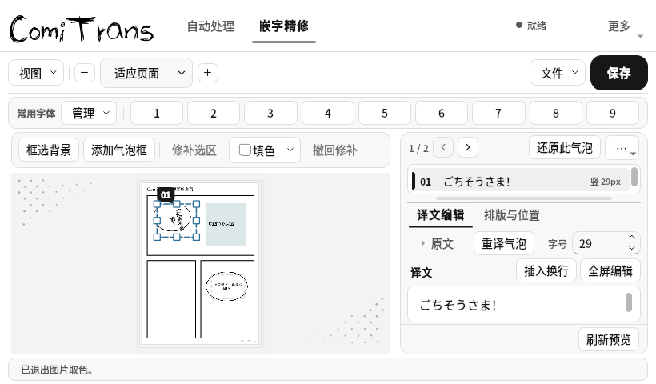 | 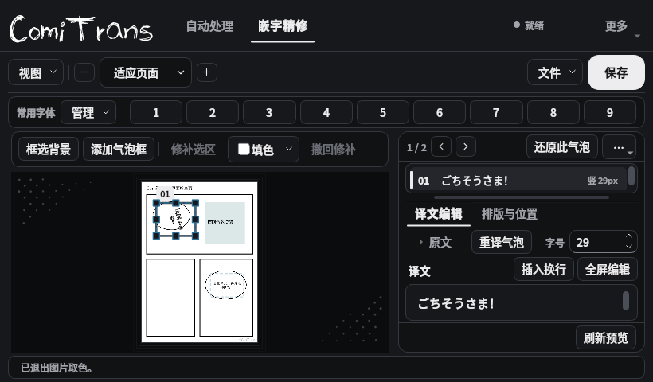 |

| Live Fork-Join Parallel Workflow Graph | Favorite Fonts (`1–9`), Fills & Lettering Controls |
| --- | --- |
|  | 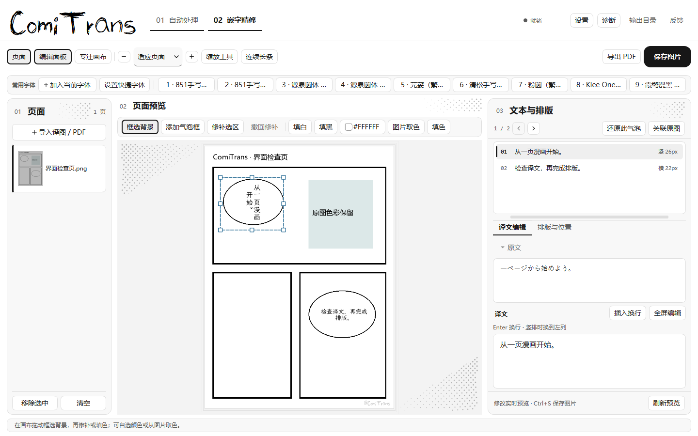 |

<details>
<summary>More screenshots & log reveal animation (Night Ink workflow, context cache, eyedropper, outlines, font library & settings)</summary>

<br>

| Night Ink Parallel Workflow | Night Ink Typesetting Editor |
| --- | --- |
| 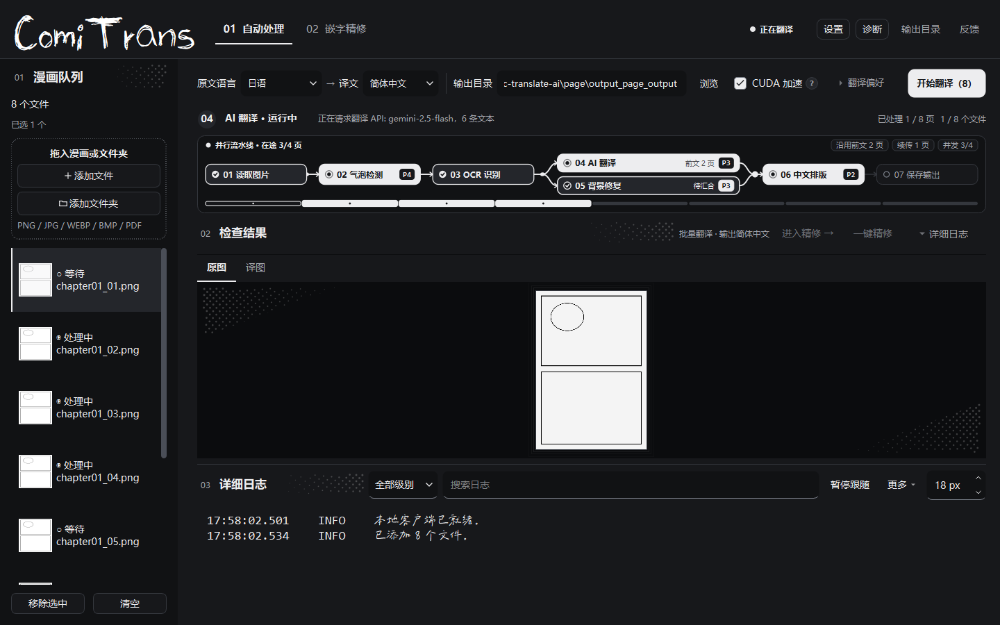 | 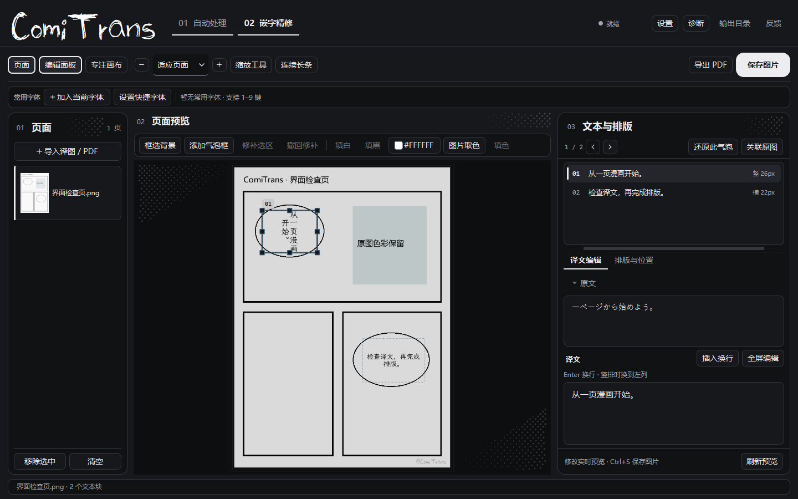 |

| Translation Preferences & Context Retention | Completed Batch & Per-Page Matrix |
| --- | --- |
| 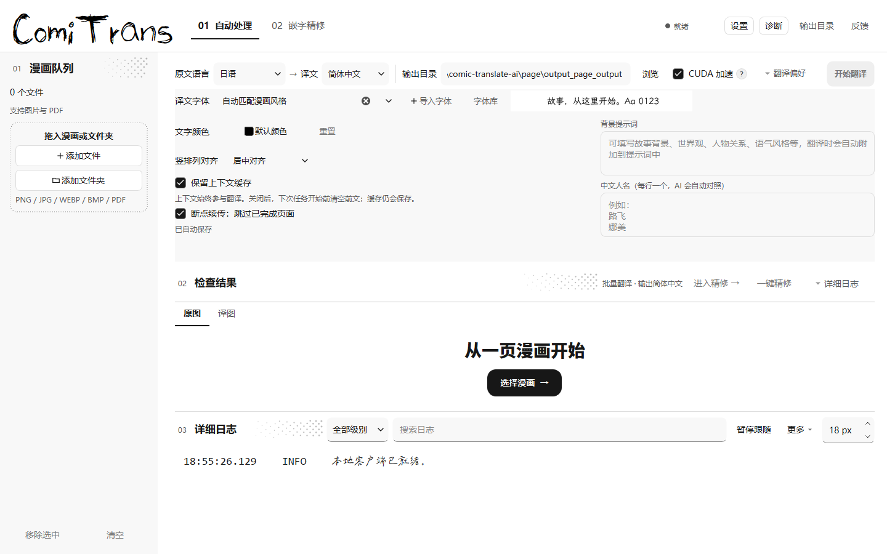 | 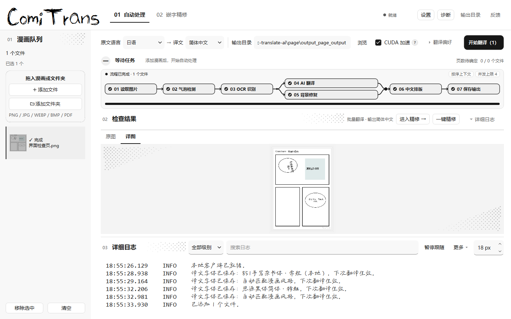 |

| Canvas Eyedropper & Custom RGB Fill | Stretch, Rotation & White-on-Black Outline Preset |
| --- | --- |
|  | 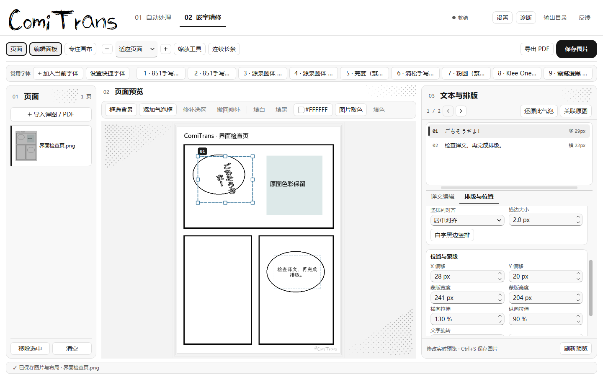 |

| Offline Google Fonts Search (2,056 Families) | Settings & Service Configuration |
| --- | --- |
| 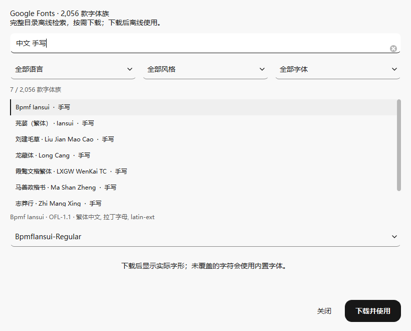 | 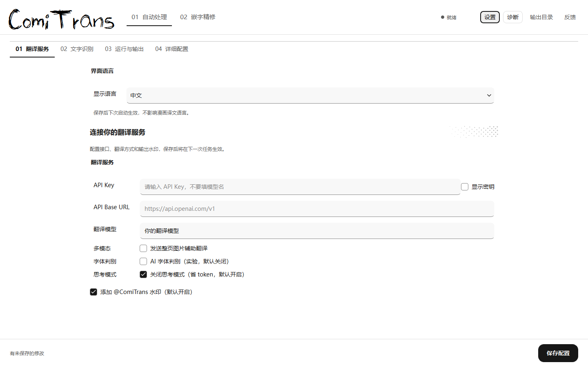 |

**Fast Character-Reveal Logs (captured from Qt)**: Logs render in the Aa handwriting font at ~250 characters/second (auto-accelerating on backlog), keeping 5,000 in-view records with search, level filtering, pause-follow, and complete disk logs.

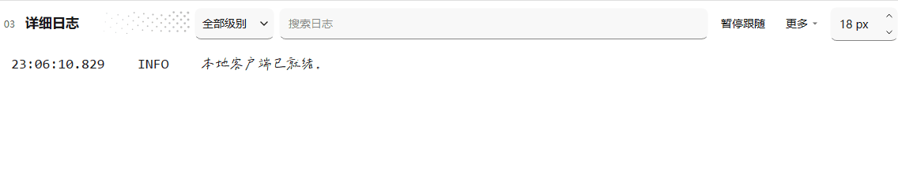

</details>

---

## Before / After

> [!NOTE]
> User-provided examples from pages 6 and 7: Japanese originals on the left, Simplified Chinese translated and lettered outputs on the right.

| Before (Japanese) | After (Simplified Chinese) |
| --- | --- |
|  | 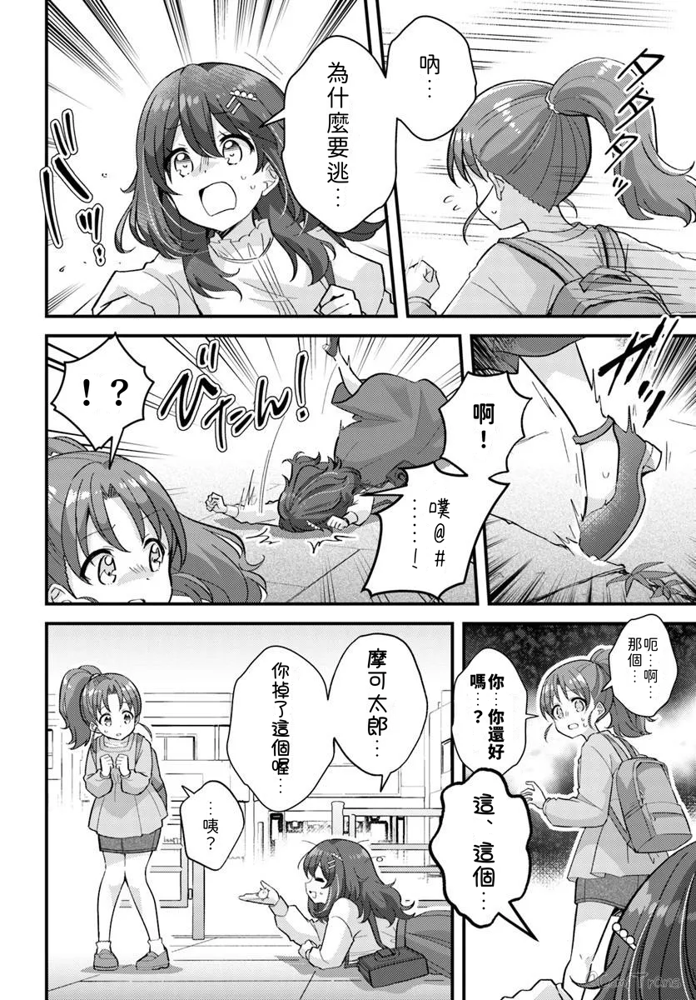 |
|  |  |

---

## Quick Start

### Windows All-in-One Installer (Recommended)

No Python installation, PyTorch, or manual model folder merging required:

1. **Download & Verify:** Download `ComiTrans-v2.6.0-x64-Setup.exe` and `SHA256SUMS.txt` from the [v2.6.0 Release Page](https://github.com/Aaaaamadeus/ComiTrans/releases/tag/v2.6.0), and verify the SHA-256 checksum in PowerShell:

   ```powershell
   Get-FileHash -Algorithm SHA256 .\ComiTrans-v2.6.0-x64-Setup.exe
   Get-Content .\SHA256SUMS.txt
   ```

2. **Run Setup:** Close any running ComiTrans instance and run Setup.
   - This build is **unsigned**; Windows may display "Unknown publisher"—verify the SHA-256 hash before running.
   - User configuration, imported/downloaded fonts, logs, and default output are stored in `%LOCALAPPDATA%\ComiTrans`, surviving upgrades and uninstalls.
   - Upgrading from `v2.6.0-pre.1` works in place; legacy MSI/WiX users should uninstall the older entry via Windows *Installed Apps* first; ZIP users can follow the [Migration Guide](docs/RELEASE-v2.6.0.md#windows-installation-verification--migration).
3. **Configure API & Optional GPU:** CPU inference is ready immediately. Open **Settings** to enter your LLM API key and model. For NVIDIA GPU acceleration, follow the official CUDA 12 / cuDNN 9 links under **Settings → Runtime & Output → GPU setup and downloads** ([GPU Setup Guide](docs/GPU_SETUP.md)).

> [!NOTE]
> UI languages include **中文 / English / 日本語** (first-launch prompt or **Settings → Translation service → Interface language**; see [UI Languages](docs/UI_LANGUAGES.md)). Completed batches have a 15% chance of showing a subtle auto-dismissing Star prompt in the bottom-right corner.

<details>
<summary>Run from source (Developers · Python 3.12+, NVIDIA GPU optional)</summary>

```powershell
cd D:\ComiTrans
python -m venv .venv
.\.venv\Scripts\python -m pip install -r comic-translate-ai/requirements.txt

# Optional: download Korean / English PP-OCRv5 ONNX models
.\.venv\Scripts\python scripts/download_ocr_models.py

# Copy example config and launch
Copy-Item comic-translate-ai/main/config.example.yaml comic-translate-ai/main/config.yaml
.\.venv\Scripts\python run.py
```

You can also double-click `start.bat`. The desktop window paints immediately while image models warm up in an isolated subprocess.

</details>

---

## Key Features

### 1. Local All-ONNX Vision & Inference Pipeline
- **Zero PyTorch Footprint:** Text detection, Japanese/Korean/English local OCR, and LaMa inpainting all run on **ONNX Runtime** with no PyTorch, torchvision, or transformers dependencies.
- **Multi-Language Source & Custom OCR:** Supports Japanese (CharSpot Small; legacy Baberu / manga-ocr packs supported), Korean & English (PP-OCRv5), plus independent HTTP OCR or OpenAI-compatible vision endpoints. Automatic mixed-language routing is not yet enabled. [Multilingual OCR Guide](docs/MULTILINGUAL_OCR.md)
- **Native-Resolution Erasing:** Erases strictly along detected text masks. LaMa tiles adaptively under memory pressure without downscaling, paired with paper-color fills, halftone/gradient reconstruction, and uniform white-bubble fallback.
- **Subprocess Warm-Up & GPU Priority:** Image model sessions warm up in an isolated process off the Qt event loop; new installations prefer NVIDIA CUDA and log the active execution provider while preserving existing CPU settings.

### 2. Context-Aware Translation & Book Workflows
- **Fork-Join Parallel Pipeline:** Immediately after OCR, sequential reading-order translation and dedicated-thread background inpainting (`repair_comic_page`) run concurrently, reconciling masks on join to skip empty translations. [Context & Parallel Guide](docs/CONTEXT_TRANSLATION.md)
- **Rolling Context & Resumable Runs:** Carries up to 12 pages / 24,000 serialized chars of context in `.cache/translation-context.json`. Per-page resume is enabled by default to skip completed pages and reuse cached paid translations. [Resume Guide](docs/RESUMABLE_TRANSLATION.md)
- **Work Terminology & Trial Estimates:** Register consistent series names in `Task → Work terminology` (only the target translation is required; checkpoints fingerprint active project terms only). Run `Trial` on the first 1–3 pages and review token usage & estimated full-book cost in `Translation usage`.
- **Whole-PDF & CBZ Support:** Import images, recursive folders, PDFs, or `.cbz` archives. PDFs render on demand with a `.comitrans` project index and background lossless export (`*_translated.pdf`); CBZ edits export cleanly back via `File → Export CBZ`. [PDF Editing Guide](docs/PDF_EDITING.md)
- **Multimodal & SC/TC Switch:** Optional multimodal toggle sends the full page image for visual context (font/size/direction stay local by default); switch Simplified/Traditional Chinese output anytime from the top workbench selector. [Chinese Output Guide](docs/CHINESE_OUTPUT.md)

### 3. Typesetting & Retouching Workbench
- **Flat Menus & Focused Canvas:** Non-nested View, File, Fill, and Font menus keep the canvas clean alongside Continuous Strip mode, single-page wheel isolation, `F2` full-screen editing, and the `Z` zoom tool.
- **Multi-Select & Cross-Page Style Brush:** Select blocks with `Ctrl`/`Shift` in the list or `Ctrl`-click/`Shift`-drag on the canvas. Use `Pick style`, `Apply style to selected`, `Style brush` (cross-page clipboard, hides drag handles, `Esc` to exit), and `Undo style` without altering text or restored bubbles.
- **Book Transcript & Single-Bubble Retranslation:** Find and replace text across the entire book in `Book transcript`, or re-translate any single block in place with `Retranslate`.
- **Precision Canvas Tools:** Manual bubble box creation, canvas/strip eyedropper color picking, undoable custom RGB/Hex fills, background selection repair, and reversible per-bubble original restoration (`Restore bubble`).
- **15 Font Categories & Offline Font Library:** Automatic classification across 15 manga styles with 3x Lanczos supersampling, stretch (`10–400%`), rotation (`±180°`), manual outline stroke (`0–30 px`), 9 pinned favorite font slots (`1–9` shortcuts), 10 bundled TC manga font families, Swei B2/Toothpaste Black faces, and **2,056 Google Fonts families** downloadable on demand for offline use. [Font Library](docs/FONT_LIBRARY.md) · [Custom Fonts](docs/CUSTOM_FONTS.md)

### 4. Diagnostics, Safe Control & Update Checks
- **Character-Reveal Logs & AI Diagnostics:** Logs write to `Log/app.log`; Diagnostics gathers environment info, model paths, and stack traces with one-click diagnosis prompts and multi-turn AI troubleshooting.
- **Safe Cancellation & Quiet Update Check:** Stopping waits gracefully for in-flight pages without scheduling new ones. Startup checks GitHub for newer stable releases and surfaces a compact `Update` button beside `Models ready` when available.

---

## Translation Pipeline

```text
Load Images / PDF / CBZ ──▶ Bubble & Text Detection ──▶ Source OCR
                                                            │
            ┌───────────────────────────────────────────────┴───────────────────────────────────────────────┐
            ▼                                                                                               ▼
   [ Branch A: Sequential Contextual Translation ]                                               [ Branch B: Background Inpainting ]
   Rolling context (up to 12 pages) + Work Terminology                                           Solid fill / halftone / tiled LaMa
            └───────────────────────────────────────────────┬───────────────────────────────────────────────┘
                                                            ▼
                     Join & Mask Reconciliation ──▶ 3x Supersampled Chinese Typesetting ──▶ Save / Export PDF · CBZ
```

1. **Detection:** ONNX detector extracts bubbles, text masks, and text lines.
2. **Source OCR:** CharSpot Small for Japanese, PP-OCRv5 for Korean/English, or a configured Custom OCR endpoint; empty sources/translations preserve original artwork.
3. **Branch A · Contextual Translation:** Combines Work Terminology and up to 12 pages / 24,000 chars of rolling context; Multimodal mode attaches the full page image.
4. **Branch B · Parallel Background Repair:** Inpaints concurrently in a worker thread while waiting on the API; join-stage reconciliation drops masks for empty translations.
5. **Chinese Typesetting:** Estimates font size from effective mask area, centers on mask centroid, adapts direction, and renders vertical ellipsis/em-dash runs cleanly.
6. **Save & Reversible Editing:** Writes output images, `<output_dir>_cleaned/` canvases, and `<output_dir>_layout/` JSON for lossless continuation in the Typesetting Editor.
7. **Book Assembly:** Rebuilds full PDFs at original page sizes (covering fractional edges) once every page succeeds, or exports edited pages to `.cbz`.

> On HTTP `401/403` (auth), `402` (insufficient balance), or `404` (endpoint/model missing), ComiTrans reports the exact cause and stops scheduling remaining pages.

---

## Models & Documentation

### Bundled ONNX Models

| Role | Default Model | Reference |
| --- | --- | --- |
| **Comic text blocks & lines** | ogkalu Small INT8 + PP-OCRv6 manga | [Pinned sources, licenses & SHA256](docs/models/split-detector.json) |
| **Japanese OCR** | CharSpot Small | [Model card, vocab & license](docs/models/charspot-small.json) · [v2.5.1 Benchmark](docs/MODEL_UPGRADE-v2.5.1.md) |
| **Korean / English OCR** | `korean_PP-OCRv5_rec_mobile.onnx` / `en_PP-OCRv5_rec_mobile.onnx` | [Pinned sources & checksums](docs/MULTILINGUAL_OCR.md#韩语和英语模型) |
| **LaMa Inpainting** | `lama-manga-dynamic.onnx` | [License audit](docs/MODEL_UPGRADE-v2.5.1.md) · [Alternative models](docs/ONNX_MODELS.md) |

### Documentation Index

| Topic | Link | Topic | Link |
| --- | --- | --- | --- |
| **v2.6.0 Release & Migration** | [RELEASE-v2.6.0.md](docs/RELEASE-v2.6.0.md) | **Windows Packaging & Signing** | [WINDOWS_INSTALLER.md](docs/WINDOWS_INSTALLER.md) |
| **Context & Parallel Pipeline** | [CONTEXT_TRANSLATION.md](docs/CONTEXT_TRANSLATION.md) | **Multilingual & Custom OCR** | [MULTILINGUAL_OCR.md](docs/MULTILINGUAL_OCR.md) |
| **PDF Editing & Export** | [PDF_EDITING.md](docs/PDF_EDITING.md) | **Font Library & Custom Fonts** | [FONT_LIBRARY.md](docs/FONT_LIBRARY.md) · [CUSTOM_FONTS.md](docs/CUSTOM_FONTS.md) |
| **Live Preview & Performance** | [EDITOR_LIVE_PREVIEW.md](docs/EDITOR_LIVE_PREVIEW.md) · [EDITOR_PERFORMANCE.md](docs/EDITOR_PERFORMANCE.md) | **Architecture & Changelog** | [ARCHITECTURE.md](docs/ARCHITECTURE.md) · [CHANGELOG.md](CHANGELOG.md) |

---

## Advanced Usage & Packaging

<details>
<summary>Advanced guides: fonts, custom OCR protocol, 15 font styles & AI diagnostics</summary>

#### Translation Fonts, Alignment & Watermark
- **Imports & Offline Catalog:** Import multiple `TTF / OTF / TTC / OTC` files into `user_fonts/` without installing them system-wide, or browse/download **2,056 Google Fonts families** on demand. Also bundles **10 Traditional Chinese manga font families (12 faces)** ([list](docs/TRADITIONAL_MANGA_FONTS.md)) and Swei B2/Toothpaste Black faces ([licenses](comic-translate-ai/font_file/Manga/README.md)), all with per-glyph fallback.
- **Vertical Alignment & Hard Breaks:** Choose top/center/bottom column alignment under **排版与位置**; press `Enter` or click **插入换行** to preserve blank lines/columns; choose black-on-white or white-on-black outline presets.
- **Watermark Toggle:** A subtle translucent `@ComiTrans` Skribble wordmark is enabled by default in the bottom-right corner; uncheck **Add @ComiTrans Watermark** in Settings (first tab) to disable persistently. Cleaned canvases stay unmarked.

#### Custom OCR Protocol
Configure independent OCR endpoints, keys, and timeouts (default 60s, range 1–300s) in Settings:
- **Standard HTTP OCR:** POSTs PNG text-region crops as Base64 (`{"image_base64": "...", "mime_type": "image/png", "language": "fr", "model": "my-ocr"}`) and expects `{"text": "...", "confidence": 0.96}`. Sends `Authorization: Bearer <key>` when set.
- **Compatible Vision API:** OpenAI-compatible Base URL, independent key, and vision-capable model using `chat.completions`.
- **Python Extension:** Implement `OcrEngine.recognize(image, language) -> OcrResult`. Full specification in [docs/MULTILINGUAL_OCR.md](docs/MULTILINGUAL_OCR.md).

#### 15 Font Style Mapping
| Style | Usage | Default Font |
| --- | --- | --- |
| `dialogue` / `bold_dialogue` | Dialogue / bold dialogue | LXGW WenKai / Source Han Sans Heavy |
| `radiating` / `sfx` | Emphasis / sound effects | Smiley Sans Oblique |
| `handwriting` / `seto` / `tegaki_851` | Handwriting / Seto / 851 (last two manual) | setofont / 851tegakizatsu |
| `thought` / `serious` | Thoughts / formal text | Source Han Serif |
| `whisper` / `cute` / `next_preview` | Whisper / playful / preview | Klee One (fallback to Source Han) |
| `narration` / `lxgw_marker` / `title` | Narration / marker (manual) / title | LXGW WenKai / LXGW Marker Gothic / Source Han Sans Heavy |

> Experimental `multimodal_font_probe` is off by default; see [docs/FONT_STYLE_STRATEGY.md](docs/FONT_STYLE_STRATEGY.md).

#### Error Logs & AI Diagnosis
- Runtime logs go to `Log/app.log`. The **Diagnostics** tab packages environment info, model paths, recent logs, and tracebacks with one-click diagnosis prompts and multi-turn AI chat until **Clear Context** is clicked.

</details>

<details>
<summary>Build the app & generate Windows Setup locally</summary>

1. Install pinned build dependencies and build the desktop bundle:

   ```powershell
   .\.venv\Scripts\python -m pip install -r requirements-build.txt
   .\build_app.ps1
   ```

   Pass `-IncludeModels` (`.\build_app.ps1 -IncludeModels`) for local testing with models.

2. With [NSIS 3.13](https://nsis.sourceforge.io/Download) installed, build the all-in-one Windows Setup (version is read from `comic_translate_desktop/__init__.py`):

   ```powershell
   .\.venv\Scripts\python.exe installer/build.py --include-models
   ```

   Full signing and CI verification workflow: [docs/WINDOWS_INSTALLER.md](docs/WINDOWS_INSTALLER.md). Historical ZIP baselines and checksums remain in `docs/releases/` ([v2.5.2](docs/releases/v2.5.2/SHA256SUMS.txt), [v2.5.1](docs/releases/v2.5.1/SHA256SUMS.txt), [v2.4.0](docs/releases/v2.4.0/SHA256SUMS.txt)).

</details>

<details>
<summary>Project Structure</summary>

```text
ComiTrans
├── run.py                         # Desktop client entry point
├── comic-translate-ai/            # AI core pipeline, ONNX detection/OCR/LaMa & Chinese typesetter
├── comic_translate_core/          # Source languages, OCR protocol, isolated image session & updater
├── comic_translate_desktop/       # PySide6 desktop app (main window, editor, workflow dialogs & motion)
├── assets/
│   ├── i18n/                      # English & Japanese UI translations
│   ├── ui/                        # SVG icons, UI fonts & empty-state illustrations
│   └── font_catalog.json          # Google Fonts catalog snapshot (2,056 families on demand)
├── installer/                     # NSIS script, release check service & verification tests
├── scripts/                       # Font catalog sync, Korean/English OCR downloader & UI review
├── docs/                          # Architecture, model manifests, benchmarks & release notes
├── tests/                         # Automated unit & desktop UI regression suite
├── build_app.ps1                  # PyInstaller build script
└── package_release.py             # Release manifest & checksum helper
```

</details>

<details>
<summary>Recent Release Summaries (v2.6.0 / v2.5.2 / v2.5.1 / v2.5.0)</summary>

- **v2.6.0 (2026-11-23):** Single-file Windows x64 NSIS Setup with bundled models, isolated subprocess model warm-up, quiet stable update indicator, Work Terminology, 1–3 page Trial runs & token/cost estimation, CBZ import/export, flat editor menus, block multi-select & cross-page Style Brush/undo, Book Transcript search/replace, single-bubble Retranslate, and 60fps monochrome motion across Paper & Night Ink themes. [Release notes](docs/RELEASE-v2.6.0.md)
- **v2.5.2 (2026-11-17):** Rolling cross-page translation context with cache retention, OCR-forked sequential translation ∥ background repair Fork-Join pipeline, live workflow topology visualizer & per-page matrix, manual bubble frames, eyedropper & RGB fills, 9-slot favorite fonts (`1–9`), stretch/rotation/outline presets, deferred post-first-paint warmup, and fractional PDF export fixes. [Release notes](docs/RELEASE-v2.5.2.md)
- **v2.5.1 (2026-11-10):** Night Ink dark theme, canvas click selection, draggable right inspector splitter, `F2` full-screen editor, `Z` zoom HUD, CUDA toggle guidance, CharSpot Small default Japanese OCR, and white-bubble fallback fill. [Release notes](docs/RELEASE-v2.5.1.md)
- **v2.5.0 (2026-11-02):** Image-based PDF workflow & lossless export, native-resolution tiled inpainting, bounded streaming pipeline, per-page resume, and reversible per-bubble restoration. [Release notes](docs/RELEASE-v2.5.0.md)

See [CHANGELOG.md](CHANGELOG.md) for the complete version history back to v1.x.

</details>

---

## FAQ

**1. Do releases require Python or PyTorch?**
No. The v2.6.0 Windows Setup bundles the runtime, fonts, and default ONNX models for out-of-the-box CPU inference. For NVIDIA GPU acceleration, follow the in-app links under Settings → Runtime & Output to install a compatible NVIDIA driver, CUDA 12, and cuDNN 9.

**2. Where do models go?**
The v2.6.0 Setup installs default models automatically alongside the app. Korean/English OCR models can be downloaded via `scripts/download_ocr_models.py` or copied from legacy packs; older ZIP releases keep models in `ComiTrans\comic-translate-ai\models\`.

**3. Why is English text not translated in Japanese mode?**
Japanese local mode intentionally preserves detector-labeled English blocks and high-Latin-ratio OCR output. For English manga/comics, switch Source Language to English; Korean, English, and Custom OCR modes translate English regions normally (automatic mixed-language routing is not enabled).

**4. Why does Windows show "Unknown publisher" when running Setup?**
This release is currently unsigned. Always download from [GitHub Releases](https://github.com/Aaaaamadeus/ComiTrans/releases) and verify the installer hash against `SHA256SUMS.txt` before installing.

---

## Feedback

Report bugs or request features via [GitHub Issues](https://github.com/Aaaaamadeus/ComiTrans/issues) or the **Issue** button in the top-right corner of the app. Attaching the diagnosis prompt generated on the **Diagnostics** page helps pinpoint issues quickly.

---

## License

- **Source Code:** Licensed under [GPL-3.0](LICENSE).
- **Bundled Chinese Fonts:** Smiley Sans, LXGW WenKai, LXGW Marker Gothic (SIL OFL 1.1), Klee One, Source Han Sans/Serif, SetoFont, and 851tegakizatsu are free for commercial use under their respective licenses; see [docs/TRADITIONAL_MANGA_FONTS.md](docs/TRADITIONAL_MANGA_FONTS.md) for the TC manga bundle.
- **UI Fonts:** Skribble and Aa retain their embedded copyright notices; see [assets/ui/fonts/README.md](assets/ui/fonts/README.md).
- **AI Models:** CharSpot Small weights use CC BY-NC-SA 4.0; full attributions, sources, and terms are listed in [docs/ONNX_MODELS.md](docs/ONNX_MODELS.md).
