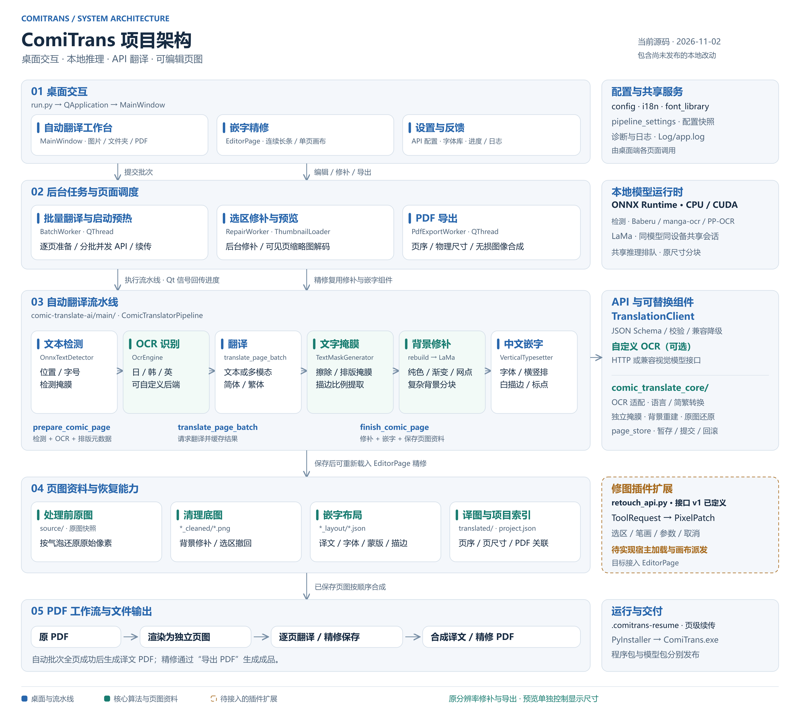

# ComiTrans 项目架构

依据 2026-11-02 的本地源码整理，包含当前尚未发布的改动。ComiTrans 由 PySide6 桌面端协调本地检测、OCR、背景修补和嵌字，通过配置的 API 获得译文，再将结果保存为可继续精修的页图资料。

PNG 为 3600 × 3220 像素。SVG 保留文字、方框和连线，可继续编辑并导出其他尺寸。[PNG 图片](images/comitrans-architecture.png) · [SVG 源图](images/comitrans-architecture.svg)

图中实线箭头表达主要处理顺序或调用关系，右侧列出共享服务、运行依赖和扩展接口。橙色虚线框标明修图插件的宿主接入尚待实现。

**模块与职责**

| 模块 | 当前职责 | 主要代码位置 |
| --- | --- | --- |
| 桌面入口 | 创建 QApplication、初始化主题与语言、显示主窗口 | `run.py`、`comic_translate_desktop/main.py` |
| 工作台与精修界面 | 文件导入、批次操作、页图浏览、逐块改字、背景修补和导出 | `comic_translate_desktop/ui/main_window.py`、`ui/editor_page.py`、`ui/preview.py`、`ui/strip_preview.py` |
| 后台调度 | 延迟后台预热、有上限的页面流水线、前处理/API 与修补重叠、进度与取消 | `comic_translate_desktop/worker.py`、`comic_translate_core/page_prefetch.py` |
| 推理调度 | CUDA 运行库初始化、实际设备提示、公平排队与取消；CPU 推理可独立运行 | `comic_translate_core/onnx_session.py`、`inference_control.py` |
| 精修后台作业 | 后台索引、页面解码、旧布局迁移、有限载入队列和保存快照 | `comic_translate_desktop/editor_jobs.py` |
| 精修局部合成 | 原像素区域复合、文字图层、水印与原图还原；界面只更新受影响区域 | `comic_translate_core/page_compositor.py` |
| 翻译流水线 | 将检测、OCR、翻译、修补、排版与落盘串联起来 | `comic-translate-ai/main/comic_translator_pipeline.py` |
| 翻译服务与协议 | API 请求、严格 JSON 校验、兼容降级、有限重试及配置快照 | `comic_translate_core/translation.py`、`translation_format.py`、`pipeline_settings.py` |
| 本地模型适配 | ONNX 文本检测、日文 OCR、韩英 PP-OCR、LaMa 推理 | `comic-translate-ai/main/onnx_*.py`、`main/manga_lama.py`、`comic_translate_core/onnx_ppocr.py` |
| 可复用算法 | OCR 协议适配、语言与简繁、独立文字掩膜、背景重建、气泡原图还原 | `comic_translate_core/ocr.py`、`languages.py`、`chinese.py`、`text_mask.py`、`background_reconstruction.py`、`restoration.py` |
| 中文排版 | 字体选择、横竖排、标点、换行、文字颜色和描边 | `comic-translate-ai/main/vertical_typesetter.py`、`text_style.py`、`punctuation_layout.py` |
| 文档与持久化 | PDF 页图项目、页级续传、后台导出、精修文件联动保存 | `comic_translate_desktop/pdf_project.py`、`pdf_utils.py`、`pdf_export.py`、`checkpoints.py`、`comic_translate_core/page_store.py` |
| 插件接口 | 定义工具、选区、笔画、参数、取消和像素补丁协议 | `comic_translate_desktop/retouch_api.py` |
| 打包交付 | 构建桌面 EXE，分别发布程序与模型包 | `ComiTrans.spec`、`build_app.ps1`、`package_release.py` |

**自动翻译的数据流**

1. `MainWindow` 将文件列表和配置交给 `BatchWorker`。PDF 先读取页序和物理尺寸，再在并发设置限定的在途页数内按需渲染独立页图，复用有效缓存；不会预先生成整本页图。PDF 资源由准备线程创建、使用并释放。
2. `prepare_comic_page()` 执行本地文本检测和 OCR，得到原文、检测掩膜、气泡位置、字号与方向等元数据。`PagePrefetch` 准备一页即提交其 API 请求。每页译文就绪便按输入顺序修补，释放名额后继续补入下一页；不等待整批。准备上下文与修补上下文隔离页状态，共用模型。
3. `translate_page_batch()` 将配置快照交给独立 `TranslationClient`，请求大模型服务、严格校验返回 JSON，并处理简繁输出。多模态选项决定请求是否附带页图。可选的自定义 OCR 通过其独立配置的 HTTP 或视觉模型接口识别原文。
4. `finish_comic_page()` 调用可替换的 `TextMaskGenerator`，获得擦除掩膜、排版掩膜和可选的原稿描边比例。纯色按实际底色填补，经过背景校验的渐变与规则纹理使用局部重建，复杂背景进入 LaMa 原分辨率分块修补。
5. `VerticalTypesetter` 在清理底图上绘制译文。异常传递为页面失败；`PageWriteTransaction` 将图像和布局暂存在磁盘，全部准备好才提交，替换失败回滚。原图资料、清理底图、布局 JSON 和译图共同构成可继续编辑的结果，续传信息由 `DocumentCheckpoint` 按页保存。

跨页 CPU 工作和 API 等待可与修补重叠。CUDA 推理通过 `InferenceGate` 公平排队，在 LaMa 分块之间交错检测/OCR，限制同时推理的资源争用。检查点使用可重入锁同步 API 缓存与完成记录。取消或全局 API 错误会停止后续预取，已发出请求的合法响应仍缓存供续传。[流水线实测](TRANSLATION_PERFORMANCE.md#连续流水线与负载重叠)

**精修与 PDF 的关系**

`EditorPage` 载入清理底图和布局，把文字作为独立可重绘内容。字体、位置、蒙版和白描边修改复用排版器。背景选区交给 `RepairWorker`，复用背景重建与 LaMa。自动流水线与精修按模型路径、文件版本和设备共享 LaMa 会话，同一会话的推理排队；各自保留取消与分块状态。设备或模型设置更新后精修更换引擎，正在运行的修补仍持有原引擎，模型无持有者时释放共享缓存。气泡还原由原图快照和逐块区域记录支持。长条浏览和缩略图按可见范围加载，预览尺寸与修补、保存所用的页图分辨率分别管理。

精修保存联动写入译图、布局及发生修改的底图。写盘前先准备文件，替换失败时恢复此前文件。背景撤回历史保存在当前会话的内存中，保存成功后释放。PDF 项目通过 `project.json` 保存页尺寸等信息，通过同名 `.comitrans.json` 将译文 PDF 关联到页图项目。

自动批次在全页成功后合成译文 PDF。精修通过显式的“导出 PDF”操作调用 `PdfExportWorker`，从已保存页图按顺序无损合成，并保持原 PDF 的页面物理尺寸。[PDF 工作流](PDF_EDITING.md) · [断点续传](RESUMABLE_TRANSLATION.md) · [精修说明](EDITOR_LIVE_PREVIEW.md)

**扩展边界**

`OcrEngine` 统一不同 OCR 后端。`TextMaskGenerator.generate()` 支持替换文字掩膜算法，`mask_debug` 可独立输出掩膜及诊断。`retouch_api.py` 已定义插件接口 v1，插件工具接收带底图、手势和参数的 `ToolRequest`，返回 `PixelPatch`。宿主的插件发现、工具注册、画布派发及撤回保存接入仍待实现。[文字掩膜组件](TEXT_MASK_COMPONENT.md) · [修图插件接口](RETOUCH_PLUGIN_API.md)

本轮服务拆分、JSON 约束与兼容策略见 [翻译 JSON 约定](TRANSLATION_JSON_CONTRACT.md)。精修界面的编辑状态管理和排版器返回结构仍可继续拆分；修图插件宿主接入状态不变。

大 PDF 的画布复用、异步保存和验证范围见 [精修性能说明](EDITOR_PERFORMANCE.md)。
