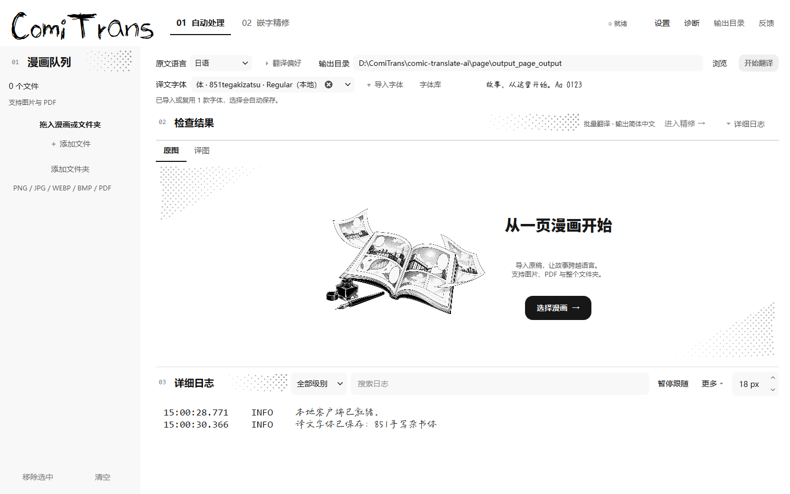

# 自选译文字体

字体操作直接位于**翻译页**，无需进入设置。

1. 在顶部“译文字体”下拉中选择已有字体，旁边会显示真实字形预览；小窗口隐藏预览以保留操作空间。
2. 添加自己的字体时，点击“＋ 导入字体”，选择一个或多个 TTF、OTF、TTC、OTC 文件。导入后自动选中最后一款成功导入的字体；字体集合使用第一个款式。
3. 选择会自动保存，下次翻译使用该字体。切回“自动匹配漫画风格”恢复各类原有风格字体。
4. 输入字体名称可检索本地字体，点击“字体库”可搜索完整开源目录、按需下载并离线使用。[字体库与精修选择说明](FONT_LIBRARY.md)。

## 生效范围

- 选定具体字体后，全部译文使用它；字号、横竖方向和布局仍由现有排版逻辑决定。
- 字体缺少某个字符时，逐字回退到内置中文字体。已选文件缺失或损坏时，提示不可用并使用自动匹配。
- 预览使用与漫画输出相同的嵌字器，包含实际缺字回退效果。
- 精修中的页面同步更新仍跟随默认字体的文本块，保留译文草稿与排版数据；手动选定的块保持自己的字体，点击“保存图片”后才覆盖输出。
- 修改字体复用已加载的本地模型；指定字体时，实验性模型字体比对不覆盖用户选择。导入与预览只在本地执行。

## 字体库与更新

字体复制到应用目录的 `user_fonts` 文件夹，不安装到系统。重复字体按文件内容复用，不因改名重复保存；删除原始导入文件后，应用内字体仍可用。导入和下载的字体在列表中标记“（本地）”。

配置中的 `translation_font` 保存相对引用，随整个应用目录一起移动仍可恢复。更新程序时保留 `user_fonts`、`config.yaml`、模型与输出文件。

## 验证记录

- 完整 163 项回归通过；字体回归覆盖复制、去重、损坏副本修复、重启与迁移恢复、缺字回退、模型复用、精修草稿保留、配置保存失败，以及字体库检索、下载、取消、离线复用和块级字体优先级。
- 正常与 200% 缩放各完成 33 张真实窗口截图；检查大窗口、1024×720、960×540、820×480 窗口中的字体入口。
- 临时打包程序使用隔离配置和实际 ONNX 模型启动，验证导入、持久化、嵌字器更新、模型复用和精修联动，未发送翻译请求。

[窗口检查](ui-review/style-review.json) · [200% 检查](ui-review/style-review-200.json) · [打包验证](ui-review/font-startup.json)

v2.4.0 新 EXE 已完成实际模型预热、字体导入与持久化、字体目录检索和精修联动验证。[发布验证](ui-review/release-v2.4.0.json)。可下载新版程序，或双击根目录 `start.bat` 运行源码。
