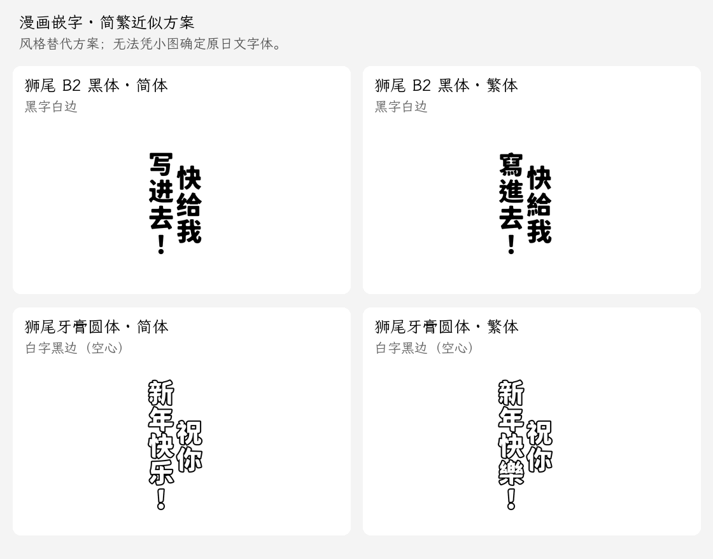
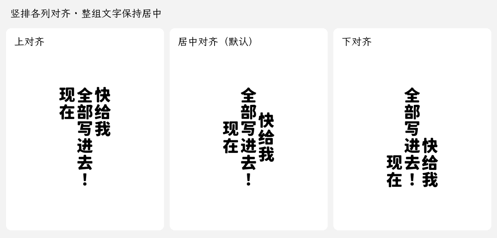
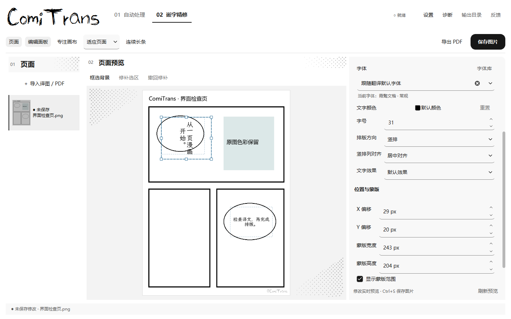

# 精修蒙版与热预览

## 按气泡还原（源码新增）

选中右侧文本块后点击“还原此气泡”，可同时撤销该块的擦字修补与嵌字，恢复处理前的原始像素。点击“保存图片”保留，也可用“恢复处理结果”切回。PDF 页图同样支持；旧结果可关联同尺寸原图。详见 [气泡还原说明](BUBBLE_RESTORATION.md)。

## 按词换行与原文排版判断（源码新增）

中文译文横排换行、竖排换列时会优先在词语边界断开。例如一列只能放三字时，“去图书馆看书”分成“去／图书馆／看书”；增加到四字后变成“去图书馆／看书”。单个词超过一行或一列的容量时仍可拆字，括号和句末标点继续遵守避头尾规则，连续省略号和破折号保持完整。

分词使用本地 jieba，简繁译文均参与判断，显示保留原有字形。拖动精修蒙版或改变字号后重新计算断点，自动断点只用于绘制；译文中的手动回车和空行优先。源码用户更新后需安装最新 `comic-translate-ai/requirements.txt`。

新翻译页面在检测到至少两条方向明确、且占该块至少三分之二的原文行时，采用字行方向，并用字行厚度的中位数约束异常大的检测字号。适用于宽幅连体气泡中的多列竖排文字，也能识别上下叠放的横排原文。证据不足时沿用已有检测与宽高判断，已有布局仍使用保存的方向和字号，精修可以手动调整。

## 自选背景修补（源码新增）

在精修画布上方点击 **框选背景**，拖动框住白印及其残边，尽量避开完好的轮廓线。可拖动边角调整范围，在框外重新框选，或按 **Esc** 取消本次拖动。点击 **修补选区** 后，程序先检查能否从周围像素接回底色、渐变或规则网点，复杂画面交给本地 LaMa 修补。操作只替换选区内的底图像素，译文仍可独立排版。再次点击 **框选背景** 退出该模式即可调整文字。

每次修补只在内存中保留选区处理前的原始像素。未保存时，点击 **撤回修补** 可逐步使用缓存恢复原图，保留文字修改。点击 **保存图片** 或 **Ctrl+S**，同时保存图片、清理底图和布局；全部保存成功后释放撤回缓存，之后的修补从新保存的底图开始。重新打开页面仍保留已保存的修补结果。

修补或保存失败时保留当前草稿和已有撤回缓存，可重试。修补进行中暂不可保存、切页或退出；完成后恢复。切页时选择放弃会释放该页缓存。缓存仅在当前会话中有效。无文本块但有配套底图和布局的页面也支持背景修补。

## 文字颜色（源码新增）

翻译页展开 **翻译偏好 → 文字颜色**，点击色块选择任意 RGB 颜色，也可在选色窗口输入十六进制色值。选择自动保存，用于后续图片和 PDF 翻译；现有精修页面保留各自的颜色。

精修页在 **排版与位置 → 文字颜色** 修改当前文本块。确认选色后立即预览；横排、竖排、标点和描边均使用所选填色。保存图片或 Ctrl+S 会同步保存布局，重新打开后保持颜色。

点击 **重置** 恢复默认颜色。默认效果和白色描边使用黑字，黑色描边（空心）默认使用白字；自选颜色只改变填色。取消选色不会修改当前文字、图片或布局，旧布局保持原有黑白效果。

## 手动分行与空心字

翻译页展开 **翻译偏好**，即可选择默认译文字体和默认竖排列对齐。两项自动保存，用于后续图片与 PDF 翻译；新生成的精修布局记录对齐方式，已有精修草稿保留各自设置。偏好区域默认折叠，小窗口中可在区域内滚动访问背景提示词和人名。

在“译文编辑”文本框按 **Enter**，或点击 **插入换行**，即可在光标处插入硬换行。横排从上到下分行，竖排从右到左换列；连续回车形成空行或空列。手动换行优先于自动标点禁则，每行/列内容过长时仍会继续自动折行。修改立即预览，Ctrl+S 同时保存图片和布局，重新打开保留分行。

竖排中，连续省略号和破折号作为整体换列，较长的标点串也不会从中间拆开；省略号的各点等距排列，破折号绘制成连续竖线，兼容 `…`、`⋯`、`︙`、`—`、`―`、`︱` 等形式。显式 Enter 仍在指定位置换列；横排和英文、数字中的句点保持原有处理。

在“排版与位置 → 文字效果”中选择 **白色描边** 或 **黑色描边（空心）**，配合默认颜色即可得到黑字白边或白字黑边。效果只作用于当前块，切换字体、方向和字号后继续生效。旧布局默认保持原有效果。

新翻译若识别出原文带白描边，会自动为该文本块选择 **白色描边**。描边按原稿的边宽与字号比例绘制，调节中文字号时会一起变粗或变细。旧页面或自动识别漏掉的文本块可以手动选择 **白色描边**，使用默认描边比例。

样图风格的简繁近似搭配：粗重强调字使用“狮尾B2黑体（简体/繁体） · 特黑”；圆润空心字使用“狮尾牙膏圆体（简体/繁体） · 特黑”加“黑色描边（空心）”与默认颜色。它们是风格替代方案，不能据小图确定原日文字体。[字体与来源](../comic-translate-ai/font_file/Manga/README.md)。

## 蒙版与实时调整

“排版与位置 → 竖排列对齐”提供 **上对齐／居中对齐／下对齐**。上、下对齐以最长列的顶部或底部为共同基准，整组文字仍在蒙版中居中，短列不再各自居中。适用于手动换列和自动折列，空列仍保留横向间隔；每个文本块分别保存。旧布局默认居中，横排时该选项禁用，切回竖排后保留选择。

在“嵌字精修”页选择已翻译图片和文本块，画布会显示带八个拖拽点的蒙版框。

1. 调整**字号**，画布自动显示实际字号；0 为自动适配。
2. 调整 **X / Y 偏移**，移动该块的译文与排版区域。
3. **拖动蒙版四角**同时改变宽高，**拖动边缘**单独改变宽或高；不锁定比例。**框内拖动**移动位置，拖动中按 **Esc** 恢复本次拖动前的范围。右侧“蒙版宽度 / 高度”可输入精确尺寸；“显示蒙版范围”控制辅助框。
4. 点击**保存图片**或按 **Ctrl+S**，直接写出当前排版结果并同步保存布局。

“排版与位置”中的**字体**可输入名称检索，也可通过**字体库**下载开源字体。手动选择只作用于当前块，并优先于翻译默认字体；缺字逐字回退，保存后重新打开仍保持选择。“跟随翻译默认字体”可恢复默认。[字体库说明](FONT_LIBRARY.md)。

拖拽会同步右侧宽高、X/Y 和译文预览，在缩放、滚动与“专注画布”模式下均可操作。拖动某条边时，其对面的边保持固定；尺寸最小为 1 px，拖拽边界限制在图片范围内。

这里的蒙版是译文排版区域。缩放它会改变文字布局；背景修补通过画布上方的“框选背景”单独选区，处理清理底图。辅助框只用于精修，导出图片中不包含虚线。

译文、字体风格和横竖方向也自动预览。无需点击应用；“刷新预览”可手动重试。手动字号优先按输入数值绘制，较大的字号可结合蒙版宽高调整。

预览期间不覆盖磁盘图片；保存会立即处理仍在输入中的数值和等待中的预览。预览失败会保留修改并提示错误，修正后可重新保存。文本块切换保留各自修改，页面切换沿用保存 / 放弃 / 取消选择。

新翻译结果记录实际排版区域；旧布局也可继续精修，保存时补齐区域和尺寸信息，保留原始检测框与其它元数据。

## 验证

- 背景修补更新通过完整 **272 项**回归（含新增 15 项），窄窗口调整后补跑 **52 项**修补与精修测试。实际本地 LaMa 验证选区外像素保持不变、缓存逐像素撤回和保存后重载；中英日界面在 1440×900、820×480 及 100%／200% 缩放下检查通过。[正常缩放记录](ui-review/background-repair-review-scale-1.json) · [200% 记录](ui-review/background-repair-review-scale-2.json)。

- 文字颜色更新通过完整 **257 项**回归，界面收尾后补跑 **27 项**颜色、精修及界面语言验证；覆盖选色/取消/重置、横竖排与标点、描边、模型复用、逐块缓存及图片/布局保存恢复。三种语言、两种窗口尺寸和两档缩放共检查 **30 张**原生 Qt 截图。[颜色入口](ui-review/text-color-zh-CN-editor-1440-scale-1.png) · [验收记录](ui-review/text-color-review.json)。

- 连续标点修复通过完整 **230 项**回归并正常退出，覆盖长串与变体不拆列、不同字体及字号的等距省略号、连续破折号、描边和空心字、手动换列、自动字号适配，以及精修预览/保存/恢复一致性。[渲染样图](ui-review/vertical-punctuation-runs.png) · [验收记录](ui-review/vertical-punctuation-review.json)。

- 竖排列对齐更新通过完整 **205 项**回归并正常退出；覆盖各列首字/末字对齐、组中心不变、默认兼容、横排不受影响、缓存刷新、当前块保存和布局恢复。Windows 打包程序已验证实际模型预热、上对齐、下对齐及正常退出。[验收记录](ui-review/vertical-alignment-review.json)。

- 手动分行与文字效果更新通过完整 **200 项**回归；最终输入框布局调整后补跑 30 项精修回归，覆盖 Enter、插入换行按钮、连续空行、横竖排、实时预览、效果切换缓存和保存重载。
- 1440×900、820×480 窗口及 100%／200% 缩放下检查新增入口；保存图片像素与热预览一致。[当前界面](ui-review/manual-lettering-text-1440-scale-1.png) · [验收记录](ui-review/manual-lettering-review.json)。

- 完整 163 项测试通过，正常退出；26 项精修回归涵盖实时字号、坐标、八个拖拽点、不同缩放、滚动、取消、即时保存、页面切换、失败重试和新旧布局兼容，以及字体切换优先级、逐字回退、检索与保存恢复。
- 缓存预览与完整重绘像素一致；PNG 保存内容与当前渲染结果一致，辅助线不写入导出。
- 正常与 200% 缩放各 33 张真实窗口截图检查，通过大窗口与 1024×720、960×540、820×480 的关键操作和蒙版、字体控件访问检查；运行中的 Qt 窗口验证拖拽时的实时预览与同步数值。
- 1600×2400、20 个文本块的页面：首次渲染约 424 ms，5 次后续修改平均约 44 ms，输入合并间隔 40 ms。耗时随电脑和页面复杂度变化。

[窗口记录](ui-review/style-review.json) · [200% 记录](ui-review/style-review-200.json) · [性能记录](ui-review/editor-live-performance.json)

可使用 v2.4.0 发布 EXE，或双击项目根目录 `start.bat` 运行源码。[v2.4.0 发布说明](RELEASE-v2.4.0.md)。
