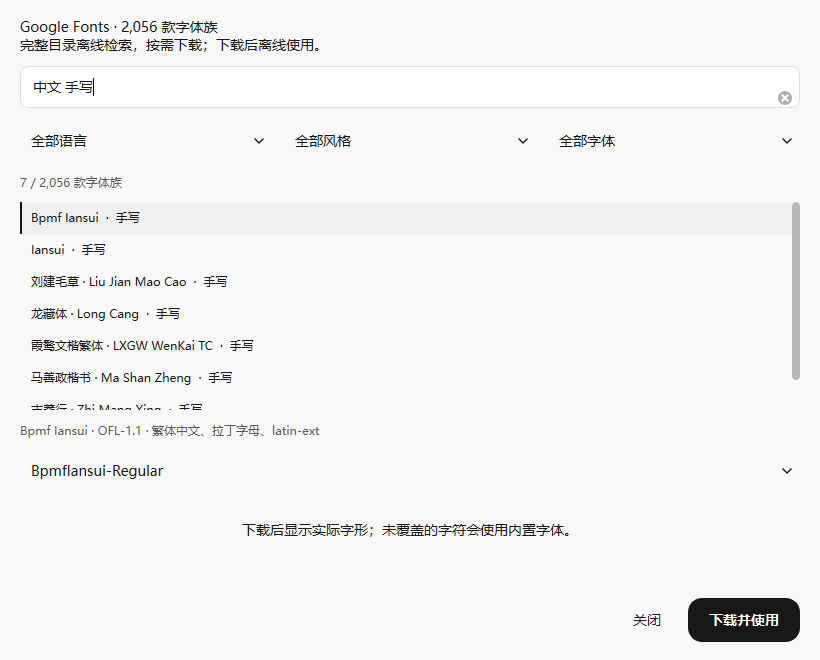
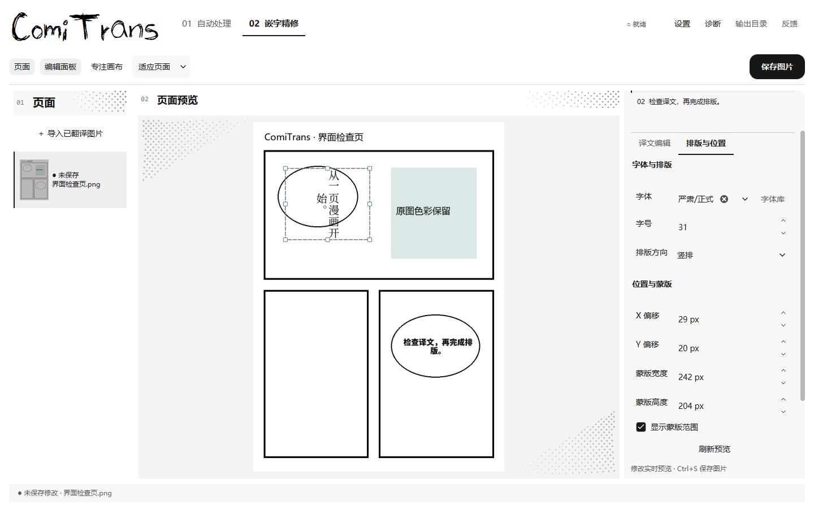

# 开源字体库与检索

翻译页“译文字体”和精修页“字体”均支持输入名称检索，忽略大小写、匹配名称中间的文字。常用中文字体带有中文别名；检索文字本身不会改变已经选定的字体，选择结果后才生效。

点击旁边的**字体库**，可离线检索完整 Google Fonts 官方仓库字体目录，按名称、中文别名、语言和风格筛选。选择字体族后，可切换上游提供的款式文件；变量字体使用文件默认轴值。点击**下载并使用**，后台下载字体及其许可证，完成校验后应用；下载期间可取消，失败后可重试。



当前快照包含 **2,056 个字体族、3,889 个款式文件**，目录文件 **1,051,291 字节，约 1 MB**；字体文件不随目录全部打包。2,046 个字体族附有独立许可证，可按需下载；另 10 个上游条目仍保留在检索目录中，因缺少许可证附件暂不提供下载。

目录来自 [Google Fonts 官方仓库](https://github.com/google/fonts)，名称、类别和语言信息补充自 [Fontsource 公开 API](https://fontsource.org/docs/api/fonts)。目录是仓库快照，收录仓库内的字体，包含上游候选字体；不代表互联网上所有免费字体。

## 默认字体与精修字体

- **翻译页**：选择会自动保存为翻译默认字体，应用到后续翻译；正在精修、仍跟随默认字体的块同步更新预览。
- **精修页**：手动选择风格或具体字体只改变当前文本块，优先于翻译默认字体。支持选择导入或下载的本地字体，修改立即预览；点击“保存图片”同时保存字体引用和输出。
- **跟随翻译默认字体**：取消当前块的手动字体，恢复使用翻译默认字体或原有自动风格匹配。
- 手动字体缺字时逐字使用内置字体，保留它能够显示的字符。字体文件缺失时提示不可用，并回退到默认字体，可重新选择后保存。



## 本地存储与更新

下载的字体与手动导入的字体保存在应用目录 `user_fonts`，选择框标记为“（本地）”。每款下载字体的原始许可证和来源记录保存在 `user_fonts/licenses`。无需安装到系统；下载一次后可在断网时使用，更新或搬迁应用时保留整个 `user_fonts` 文件夹以及配置和漫画布局文件。

目录固定到上游提交 `66928797f271fed5ee428544e7229685e2d90127`，下载使用对应版本的官方字体文件。维护者可运行 `scripts/update_font_catalog.py` 更新目录；GitHub 公共 API 限额不足时，可用无文件检出的仓库：

```powershell
git clone --filter=blob:none --no-checkout --depth=1 https://github.com/google/fonts.git tmp/font-catalog-source
.\.venv\Scripts\python.exe scripts/update_font_catalog.py --source-repo tmp/font-catalog-source
```

目录索引随 v2.4.0 程序打包，下载字体保留在应用目录的 `user_fonts` 中。可使用新版 EXE 或根目录 `start.bat` 启动。[v2.4.0 发布说明](RELEASE-v2.4.0.md)。

## 验证

- 完整 163 项回归通过，包括字体检索、后台下载与取消、失败重试、文件校验、许可证保留、离线复用，以及精修字体优先级和保存恢复。
- 正常与 200% 缩放各 33 张真实 Qt 窗口截图，检查字体库入口、字体检索、小窗口滚动访问和精修字体切换。
- 在隔离目录实际下载 Bangers（93,148 字节）和志莽行 Zhi Mang Xing（4,063,532 字节），验证字体加载、上游文件校验、许可证及本地引用。未调用翻译 API。
- 断网测试实际字体库窗口，确认已下载字体可显示真实字形并直接选用。[离线预览](ui-review/font-library-offline-preview.png)。

[实际下载记录](ui-review/font-library-download.json) · [正常窗口记录](ui-review/style-review.json) · [200% 窗口记录](ui-review/style-review-200.json)
