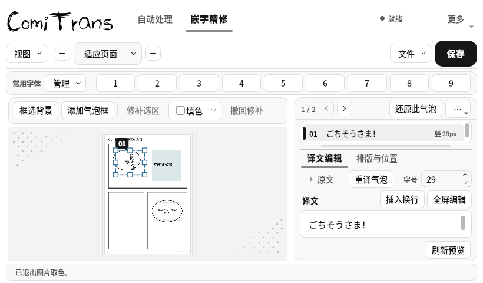
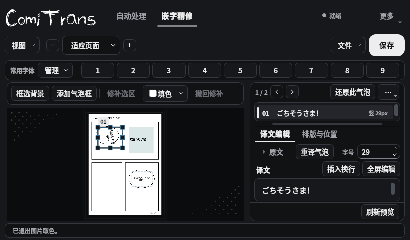

# ComiTrans v2.6.0

ComiTrans v2.6.0 现已发布。本次更新正式推出**单文件 Windows x64 安装向导**（内含桌面客户端、字体与默认 ONNX 模型），同时在工作流、精修编辑器、动效与启动性能上带来多项实质升级：新增**作品术语库、试译与翻译消耗预估、CBZ 漫画包支持**，重构精修顶部栏为**单层菜单**并加入**气泡多选、连续样式刷、全书译稿查找替换与单气泡重译**，并引入 **60fps 黑白墨韵动效、独立进程模型预热与后台正式版更新提醒**。

[核心功能更新](#一核心功能更新) · [Windows 安装与升级](#二windows-安装校验与升级迁移) · [English Release Notes](#english) · [v2.6.0 发布页](https://github.com/Aaaaamadeus/ComiTrans/releases/tag/v2.6.0)

| 模块 | 主要更新 |
| --- | --- |
| **翻译与全书工作流** | 新增「作品术语库」、1–3 页「试译」与真实 Token「翻译消耗」预估；支持 CBZ 导入翻译与保存后重新「导出 CBZ」 |
| **精修编辑器与批量排版** | 工具栏收纳为无嵌套单层菜单；支持多选气泡、「取样式 / 样式刷 / 撤销样式」、跨页「全书译稿」查找替换与「重译气泡」 |
| **视觉动效与启动性能** | 全界面 60fps 黑白墨韵动效与纸白/夜墨双主题统一；检测/修复模型隔离至独立进程预热；顶栏新增「有更新」低干扰提醒 |
| **Windows 安装与交付** | 单文件 NSIS Setup（固实 LZMA 压缩，约 681 MiB），开箱含默认模型与字体；支持自定义中文路径、静默参数与独立用户数据目录 |

---

## 一、核心功能更新

### 1. 翻译前准备与全书工作流

- **作品术语库（`任务 → 作品术语库` / 翻译偏好）**
  - 按作品记录角色、地点与统一译名；**仅需填写固定译名**，类型与识别线索均可选填，无需手填原文，也不会增加额外的识别请求。
  - 断点指纹仅纳入当前生效术语：修改其他作品术语或调整计费单价时，不会让已付费页面重新翻译。
- **试译与翻译消耗预估（自动处理页「试译」、`任务 → 翻译消耗`）**
  - 整批翻译前可先试译队列开头的 **1–3 页**（PDF 按页计数）；试译使用独立结果目录、独立上下文与独立断点，不污染正式任务进度，完成后可直接精修试译结果或一键启动正式翻译。
  - 任务或试译结束后，基于翻译接口返回的真实 Token 用量（计入无效内容重试响应）展示「翻译消耗」，并支持填写自定义单价与按样页估算整本费用。
- **CBZ 漫画包端到端支持**
  - 支持直接导入 `.cbz` 漫画压缩包按页翻译，并在「嵌字精修」保存各页后通过 `文件 → 导出 CBZ` 重新打包导出。

### 2. 精修编辑器重构与批量排版

- **单层菜单与紧凑属性栏**
  - 将「视图」「文件」「填色」「常用字体管理」等高频能力收拢为**无嵌套单层菜单**，减少工具栏遮挡并释放更多画布区域；右侧属性栏新增的快捷字号框与原字号框实时双向同步。
- **气泡多选与批量样式编辑**
  - 气泡列表支持 `Ctrl` / `Shift` 多选，画布支持 `Ctrl` 点击加选与 `Shift` 拖拽框选，右上角计数随当前选区实时更新。
  - 多选修改仅同步实际发生变化的样式字段，**严格保护译文文本、原文、蒙版位置/尺寸以及已还原原图的气泡**。
- **样式取样、连续样式刷与样式撤销**
  - 在气泡右上角 `⋯` 菜单、列表右键或画布右键菜单中使用「取样式」「应用样式到所选气泡」「样式刷」与「撤销样式」。
  - **样式刷**支持跨页共享样式剪贴板，点击或框选目标气泡即可连续套用；开启期间隐藏气泡调整手柄以防误拖，按 `Esc` 或点击「退出样式刷」结束。
  - **撤销样式**可逐次撤回当前页最近的样式改动，不会覆盖后续修改过的译文内容。
- **全书译稿跨页查找替换 & 单气泡重译**
  - 新增「全书译稿」对话框，支持跨页检索、批量替换译文并快速定位修改。
  - 右侧编辑栏新增「重译气泡」，可对单个气泡单独重新请求翻译 API，无需整页重跑。

### 3. 界面动效、双主题与启动性能

- **60fps 黑白墨韵动效与双主题统一**
  - 引入统一的 60fps 单色交互动效系统与精细化控件反馈，全面打磨「纸白」与「夜墨」双主题下的下拉框、按钮、卡片、对话框、工具栏与选中态表现。
- **独立进程模型预热**
  - 将检测（CharSpot / 文本检测）与 LaMa 背景修复等图像模型会话隔离至独立进程，彻底脱离 Qt 主事件循环；启动加载期间界面持续流畅可操作，顶栏实时反馈模型准备状态。
- **低干扰更新提醒**
  - 启动时在后台比较本地客户端版本与 GitHub 最新正式版；仅当存在更高正式版时，顶栏「模型已就绪」左侧才会出现「有更新」按钮，点击可查看版本对比与发布页下载入口（不会对正式版用户误报预发布测试版）。

| 纸白主题 · 嵌字精修（v2.6.0） | 夜墨主题 · 嵌字精修（v2.6.0） |
| --- | --- |
|  |  |

---

## 二、Windows 安装、校验与升级迁移

### 下载与安装

下载本页的 `ComiTrans-v2.6.0-x64-Setup.exe` 与 `SHA256SUMS.txt`（[v2.6.0 发布页](https://github.com/Aaaaamadeus/ComiTrans/releases/tag/v2.6.0)）。安装包采用固实 LZMA 压缩（约 681 MiB），**内置桌面客户端、全部中文字体以及默认检测、OCR 和修复模型**。

1. **校验 SHA-256**：运行安装包前，在 PowerShell 中核对两处十六进制哈希是否一致：

   ```powershell
   Get-FileHash -Algorithm SHA256 .\ComiTrans-v2.6.0-x64-Setup.exe
   Get-Content .\SHA256SUMS.txt
   ```

2. **运行 Setup**：关闭正在运行的 ComiTrans，双击安装向导。本版安装包**未签名**，Windows 可能显示「未知发布者」，请确认来自官方发布页且哈希一致后手动运行。
3. **配置翻译服务**：安装后 CPU 模式即可直接加载本地模型。首次使用请在「设置」填写翻译 API 密钥与模型；如需 NVIDIA GPU 加速，可在「设置 → 运行与输出 → GPU 安装说明与下载」按指引配置 CUDA 12 与 cuDNN 9。

### 系统集成与静默参数

- 支持自定义多级目录与中文安装路径；自动创建开始菜单与桌面快捷方式、`.comitrans` 项目文件关联及系统「已安装的应用」卸载入口。
- 用户配置 `config.yaml`、导入/下载的字体 `user_fonts`、日志与默认输出均存放在 `%LOCALAPPDATA%\ComiTrans`，卸载程序时保留用户数据。
- 静默安装支持 `/S`（区分大小写）、`/LOG="路径"` 与放在命令末尾的 `/D=安装路径`（不加引号），例如：

  ```powershell
  .\ComiTrans-v2.6.0-x64-Setup.exe /S /LOG="D:\install.log" /D=D:\Apps\ComiTrans
  ```

### 从历史版本升级 / 迁移

| 原安装形态 | 升级 / 迁移方式 |
| --- | --- |
| **v2.6.0-pre.1 预发布 NSIS 版** | 关闭应用后直接运行新版 Setup，自动沿用原安装目录与 `%LOCALAPPDATA%\ComiTrans` 用户配置 |
| **旧版 MSI / WiX 安装版** | 请先在 Windows「已安装的应用」中卸载旧版，再运行新版 Setup（用户数据目录会保留） |
| **v2.5.2 及更早 ZIP 便携版** | 可将旧目录中的 `config.yaml` 与 `user_fonts` 复制到 `%LOCALAPPDATA%\ComiTrans`；移动漫画项目时请保留漫画、`.comitrans` 索引与配套精修目录的相对位置 |

---

## English

ComiTrans v2.6.0 introduces a single-file Windows x64 installer alongside major improvements across batch translation preparation, editor ergonomics, visual polish, and startup responsiveness.

### What's New

#### 1. Pre-Translation & Full-Book Workflow
- **Work Terminology (`Task → Work terminology` & Translation Preferences):** Maintain per-series character names, places, and fixed translations. Only the target translation term is required (category and matching hints are optional, with no extra OCR/recognition calls). Checkpoints fingerprint only the active project's terms, so editing pricing or another series will not invalidate already-translated pages.
- **Trial Run & Translation Usage Estimates (`Trial` & `Task → Translation usage`):** Test the first **1–3 queued pages** (counting PDF pages individually) in an isolated output directory, context, and checkpoint before committing to a full batch. After completion, inspect token usage reported by your provider (including invalid-output retries), configure custom unit pricing, and estimate full-book cost.
- **End-to-End CBZ Support:** Import `.cbz` comic archives for page-by-page translation and export edited pages back to `.cbz` via `File → Export CBZ`.

#### 2. Editor Redesign & Batch Styling
- **Single-Level Menus & Compact Inspector:** Reorganizes View, File, Fill, and Favorite Font Management into flat, non-nested menus to keep the canvas unobstructed. A quick font-size box stays synchronized with the inspector size control.
- **Multi-Select & Batch Property Sync:** Select multiple blocks in the list (`Ctrl` / `Shift`) or directly on the canvas (`Ctrl`-click / `Shift`-drag marquee). Batch edits apply only the fields actually changed, leaving translated text, source text, mask geometry, and restored original bubbles untouched.
- **Style Picker, Continuous Style Brush & Undo:** Access `Pick style`, `Apply style to selected`, `Style brush`, and `Undo style` from each block's `⋯` button or the list/canvas context menu. Style Brush keeps a cross-page style clipboard, hides drag handles while active to prevent accidental moves, and exits on `Esc` or `Exit brush`. `Undo style` steps backward through style changes on the current page without reverting later text edits.
- **Book Transcript & Single-Bubble Retranslation:** Search and replace translations across all pages from `Book transcript`, and re-translate an individual bubble in place with `Retranslate`.

#### 3. Visual Polish, Motion & Startup Performance
- **60fps Monochrome Motion & Theme Consistency:** Adds a unified 60fps monochrome motion system and refined combo-box/control feedback across both Paper (light) and Night Ink (dark) themes.
- **Isolated Subprocess Model Warm-Up:** Moves detector, OCR, and LaMa image model sessions out of the Qt event loop into an isolated process so the UI remains responsive while models warm up.
- **Quiet Update Indicator:** Checks GitHub for newer stable releases in the background at startup. Only when a newer stable version exists does a compact `Update` button appear to the left of `Models ready`, opening a version comparison and release download link (stable users are never alerted for pre-releases).

### Windows Installation, Verification & Migration

Download `ComiTrans-v2.6.0-x64-Setup.exe` and `SHA256SUMS.txt` from the [v2.6.0 Release Page](https://github.com/Aaaaamadeus/ComiTrans/releases/tag/v2.6.0). The solid-LZMA installer (~681 MiB) bundles the desktop client, fonts, and default ONNX models so CPU inference works immediately after setup.

1. **Verify SHA-256** in PowerShell before running Setup:

   ```powershell
   Get-FileHash -Algorithm SHA256 .\ComiTrans-v2.6.0-x64-Setup.exe
   Get-Content .\SHA256SUMS.txt
   ```

2. **Install:** Close any running ComiTrans instance and run Setup. This release is **unsigned** and requires manual download/installation; Windows may show an "Unknown publisher" prompt.
3. **Configure API & Optional GPU:** Enter your translation API key and model in Settings. For NVIDIA GPU acceleration, follow the CUDA 12 / cuDNN 9 links under **Settings → Runtime & Output → GPU setup and downloads**.
4. **Upgrade / Migration:**
   - **From `v2.6.0-pre.1` NSIS preview:** Close the app and run the new Setup directly to upgrade in place.
   - **From legacy MSI / WiX builds:** Uninstall the older version in Windows *Installed Apps* first, then run Setup (user data in `%LOCALAPPDATA%\ComiTrans` is preserved).
   - **From historical ZIP editions:** Copy `config.yaml` and `user_fonts/` into `%LOCALAPPDATA%\ComiTrans`, and keep manga images, `.comitrans` indexes, and editing folders together.
