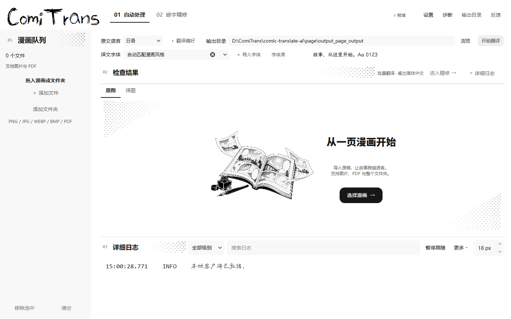
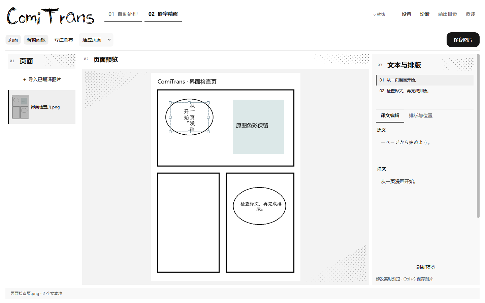
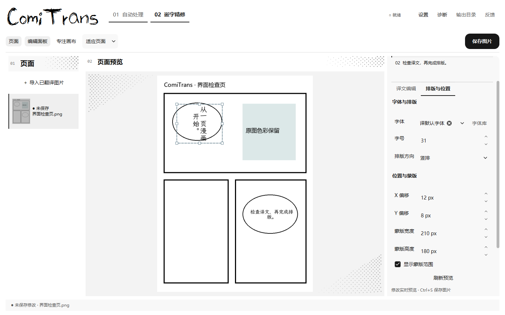
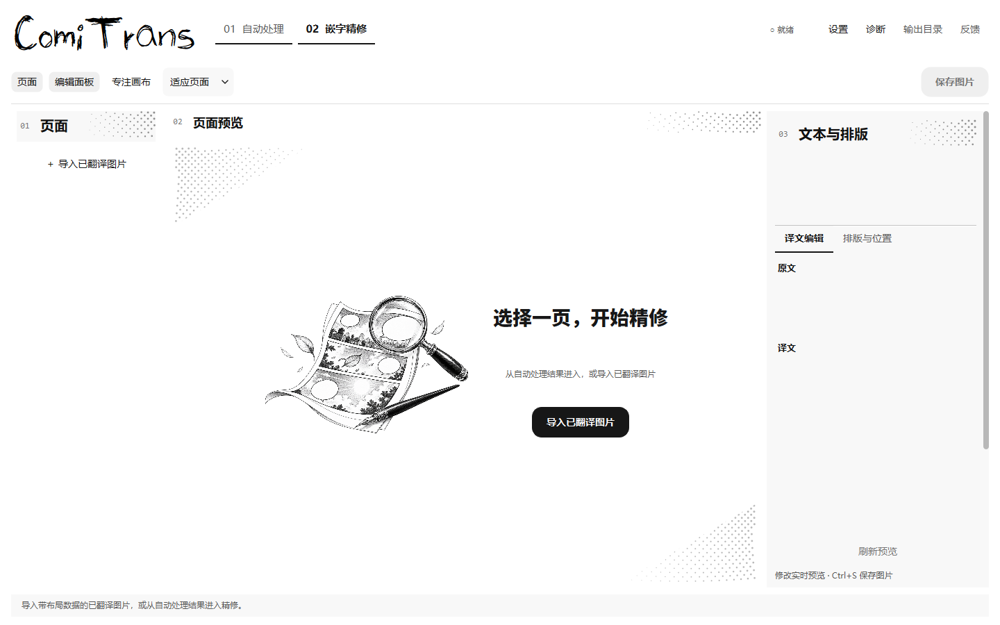
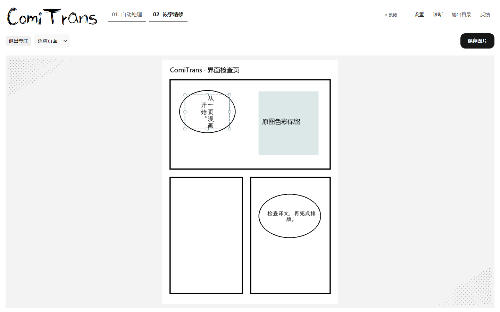
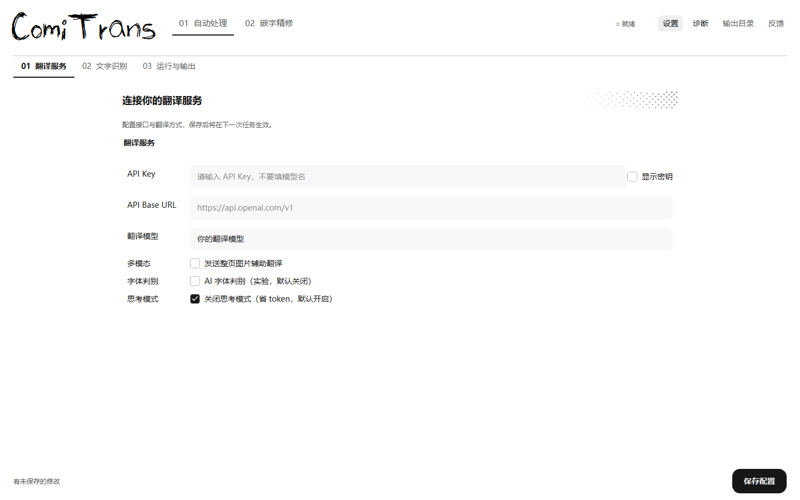
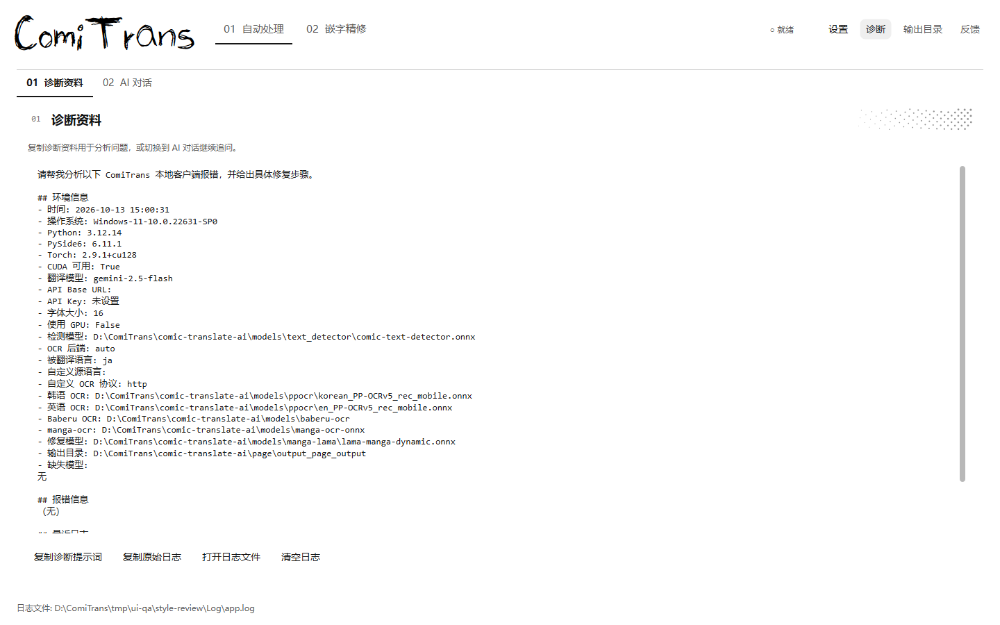
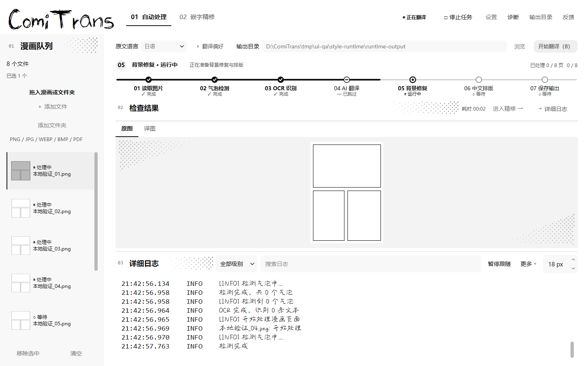

# 全应用漫画风优化 · 2026-10-08

本次覆盖自动处理、嵌字精修、设置与诊断。根据“按钮和方框过于生硬”的反馈，减少边框、黑色标题板与分隔线，以留白、浅灰底、开放式标题和柔和控件组织页面。最新调整删除四个页面的 01 / 02 / 03 / 04 通栏大横幅，直接进入操作区；漫画网点分布在分区标题、空状态边角和画布留白中。保留 Skribble 字标和 Aa 手写日志字体。

## 页面变化

| 页面 | 当前布局与操作 |
| --- | --- |
| 自动处理 | 删除通栏横幅；浅灰队列和紧凑任务操作直接置于导航下方；顶部直接选择译文字体、导入字体并自动保存；分区标题与空状态有局部网点，有页面后显示真实七节点轨道；保留原图/译图检查、独立日志和全局停止入口。 |
| 嵌字精修 | 删除通栏横幅；页面 / 画布 / 编辑三栏保留，纸灰画布留白有局部网点；浅灰编辑面板按译文 / 排版分类。字号、坐标和蒙版宽高自动预览，保存直接出图；底部保留刷新入口。“专注画布”收起侧栏与辅助信息，退出恢复此前布局。 |
| 设置 | 删除 03 通栏横幅；直接进入翻译服务 / 文字识别 / 运行与输出三类；小标题有局部网点，表单独立滚动，保存栏固定，返回设置时保留未保存输入。 |
| 诊断 | 删除 04 通栏横幅；直接进入“诊断资料”和“AI 对话”分页，保留复制日志、打开日志、诊断提示词、多轮问答与上下文操作。 |

次要按钮采用无边框文字操作，主要操作采用圆角黑色按钮；输入框用浅灰底与聚焦细线，导航与页签用文字下划线标识选中态。四个页面共用同一套标题、控件与焦点主题。

日文角标随全部冗余横幅移除，横幅专用组件和注册逻辑一起清理；原始字体资源仍保留。

常态工作区增加 116 个逻辑像素的可用高度。网点复用缓存的内联 SVG，边角裁成斜向收尖的形状；真实漫画的显示区域及其外侧 12 px 完全排除在网点绘制范围之外，原稿颜色与导出结果保持原样。日志正文和编辑输入不绘制纹理。高分屏图片预览按实际像素密度采样，避免 200% 缩放时先缩小再放大造成的模糊。

两张透明 PNG 已接入空状态，由 Qt 按比例绘制并缓存；加载真实漫画后让出画布，小尺寸隐藏插画以留出操作空间。资源不会写入漫画原稿或导出图片。通过内置生图工具生成，原始素材与完整提示词见 [素材使用与生成记录](../assets/ui/illustrations/README.md)。

## 实际界面

所有图片来自运行中的 Qt Widgets 窗口截取。精修图片是本地界面检查页，用于验证布局载入与作品原色；没有用静态设计稿代替应用运行结果。

### 自动处理



译文字体在翻译页直接修改，旁边提供导入与实际字形预览；小窗口保留选择和导入入口。具体字体应用于全部译文，也可恢复自动匹配。详见[字体使用说明](CUSTOM_FONTS.md)。


### 嵌字精修



[排版与位置](ui-review/editor-layout-style-review.png)

2026-10-12：增加排版蒙版宽高与画布范围提示；字号、X/Y、蒙版以及译文和风格修改自动热预览。手动字号按实际数值绘制，保存图片或 Ctrl+S 直接输出当前结果。[精修使用说明](EDITOR_LIVE_PREVIEW.md)。



2026-10-13：蒙版增加八个画布拖拽点。四角同时改变宽高，边缘单独调整，框内拖动位置；右侧数值与译文实时同步，Esc 恢复本次拖动前的范围。




### 专注画布

快捷键：Ctrl+Shift+F。收起页面侧栏、编辑面板和辅助信息，保留缩放、保存与全局任务操作；未保存草稿和此前侧栏偏好保留。



### 设置



[文字识别](ui-review/settings-ocr-style-review.png) · [运行与输出](ui-review/settings-output-style-review.png)

### 诊断



[AI 对话](ui-review/diagnosis-chat-style-review.png)

## 验证

- 最新字体库与精修功能完成正常与 200% 缩放各 33 张真实窗口截图检查，四个页面的横幅数量均为 0。以下截图已更新为当前界面。
- `python -X faulthandler -W error::ResourceWarning -m unittest discover -s tests -v`：163 项通过且进程正常退出。精修回归覆盖实时字号与坐标、八方向拖拽、缩放与滚动、蒙版大小、快速保存、块与页面切换、预览失败保护、旧布局兼容，以及字体优先级、检索、下载和保存恢复。
- 原生 Windows Qt 窗口检查 1440×900、1024×720、960×540、820×480；自动检查顶栏相邻控件无重叠，关键操作可见，小窗口中的蒙版输入可通过滚动访问。
- 200% 缩放检查实际 902×485 / 820×480 逻辑尺寸。字号、网点与坐标使用 Qt 逻辑尺寸；Skribble 与 Aa 字体正常解析。
- 两种缩放各截取 33 张真实窗口截图，包括字体库检索、手动字体优先级、精修空状态、正常编辑、专注画布、实时修改、蒙版范围与鼠标拖拽；确认两张 PNG 加载成功且保留透明通道。
- 20 个文本块、1600×2400 页面：首次完整渲染约 424 ms，5 次后续修改平均约 44 ms；仅重绘变化的文本块，其余图层缓存复用。[性能记录](ui-review/editor-live-performance.json)。
- 2026-10-08 临时打包程序验证实际 ONNX 预热、字体导入与持久化、更新嵌字器及精修预览；[打包验证记录](ui-review/font-startup.json)。最新精修改动验证于源码运行窗口。
- 使用真实本地 ONNX 管线处理 8 张无文字分镜页：8 成功、0 失败。外部翻译客户端被验证脚本阻断，未调用翻译 API；小窗口处理中停止按钮可见。

[窗口检查记录](ui-review/style-review.json) · [200% 检查记录](ui-review/style-review-200.json) · [本地管线记录](ui-review/style-runtime-review.json)



[820×480 处理中](ui-review/processing-820-style-review.png) · [200% 自动处理](ui-review/automatic-200-style-review.png) · [200% 设置](ui-review/settings-200-style-review.png)

## 启动与复查

双击项目根目录 `start.bat` 查看新版，或运行：

```powershell
.\.venv\Scripts\python.exe run.py
```

可重复执行隔离用户配置的界面截图检查：

```powershell
.\.venv\Scripts\python.exe scripts/review_ui.py
```

v2.4.0 已构建新版 EXE，并通过实际模型预热、字体导入与目录检索检查。[发布验证](ui-review/release-v2.4.0.json)。外部 API 翻译未作实测。
